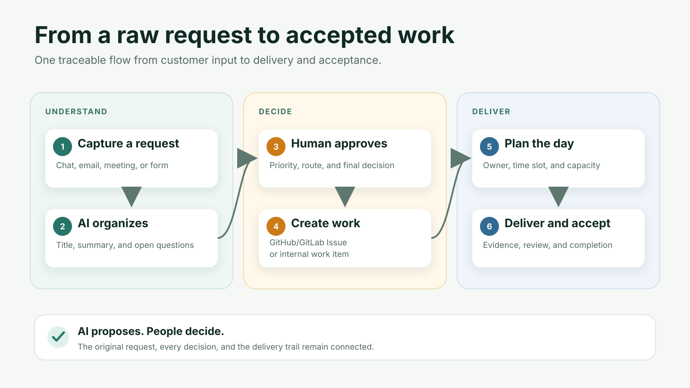

# Intake

A private intake tool for engineering leads. Customer requests arrive from chat, email, meetings and forms; AI normalizes them; the lead reviews and approves; Intake creates a GitLab or GitHub Issue (or an internal work item) and schedules it into the team's daily plan.

> Status: pilot-grade, used by a small team. The core public walkthrough is available in English with `?lang=en`; other screens and the technical documentation under `docs/` are still primarily Vietnamese.

**User guide**: every role, feature, page and button, in English and Vietnamese, at [zinisoft.github.io/intake](https://zinisoft.github.io/intake/?lang=en). The same guide is public at `/huong-dan` on any running instance. <!-- export-gate: allow (public Pages URL) -->

## How a request becomes work



Intake keeps the original request, the human decision, the delivery target and the daily plan connected. AI proposes a structured version of the request; a person still decides what happens next.

The reproducible public demo kit includes the [storyboard](demo/storyboard.md), [narration](demo/narration.en.md), [captions](demo/captions.en.vtt) and [recording safety runbook](demo/recording-runbook.md). It uses fictional data and a narrowly scoped demo repository.

## What it does
- **Intake**: capture raw requests, AI proposes a clean title, description and open questions; nothing leaves the system until the lead approves, then syncs.
- **Daily planning**: capacity, quick add, approval snapshot and per-Issue sync with retry to GitLab/GitHub.
- **Reports**: parses daily-report emails from staff and feeds unfinished tasks into the next plan.
- **Meetings**: record or upload audio, get a speaker-labelled transcript and a note that turns into Intake items.
- **Private space** (optional): your own voice and pillars for drafting posts.
- **MCP server**: let coding agents read the day's work and log progress.
- Beta: marketing posts and watched sources (behind a feature flag).

## Quick start
Needs Docker with the Compose plugin. From a clone of this repository:
```bash
bash install.sh                                                  # Linux, macOS, Git Bash
powershell -ExecutionPolicy Bypass -File install.ps1             # Windows
```
The installer writes `.env` with fresh random secrets, starts the stack on `127.0.0.1:8080` and waits until it is healthy. Open that address, create the CTO account (and optionally a Project Owner) with your own email and password, then add the API key of any OpenAI-compatible AI provider on the setup page. Back up the `.env` file: losing `SECRET_KEY` makes saved AI keys unreadable.

Until the accounts exist, the first visitor becomes the CTO, so the installer only listens on `127.0.0.1`. Do not expose the port before you finish the setup page.

To set things up by hand instead, copy `.env.example` to `.env`, fill in the secrets, run `docker compose up -d`, and sign in as `cto` with `CTO_INITIAL_PASSWORD`.

Readiness: `/api/v1/health/ready`. OpenAPI UI: `/docs`.

## AI provider
Set `AI_PROVIDER_PRIMARY=openrouter` and `OPENROUTER_API_KEY` for the simplest setup. An adapter for UModelVerse is also included; choose any OpenAI-compatible provider the same way. AI only proposes; a human decides.

## Develop
```bash
python -m pytest -q          # backend tests on SQLite
cd frontend && npx tsc -b    # frontend types
```
Read [docs/README.md](docs/README.md) first, then [CONTRIBUTING.md](CONTRIBUTING.md).

## License
Apache-2.0. Copyright 2026 ZiniSoft and contributors. See [LICENSE](LICENSE) and [NOTICE](NOTICE).
