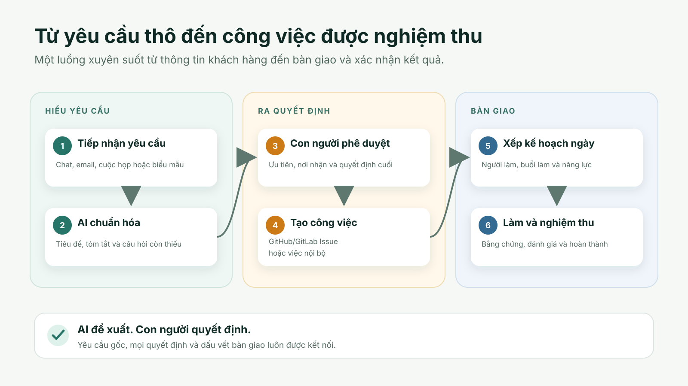

# Intake

Công cụ riêng tư để CTO tiếp nhận yêu cầu của khách từ chat, email, họp và form; AI chuẩn hóa; CTO duyệt; Intake tạo Issue trên GitLab/GitHub (hoặc việc nội bộ) rồi xếp vào kế hoạch ngày của đội.

> Trạng thái: mức pilot, một đội nhỏ đang dùng. Luồng walkthrough public chính có bản tiếng Anh qua `?lang=en`; các màn hình khác và tài liệu kỹ thuật vẫn chủ yếu bằng tiếng Việt. README tiếng Anh: [README.md](README.md).

## Một yêu cầu trở thành công việc như thế nào



Intake giữ yêu cầu gốc, quyết định của con người, nơi giao việc và kế hoạch ngày trong cùng một hành trình. AI đề xuất bản yêu cầu có cấu trúc; con người vẫn quyết định bước tiếp theo.

Bộ demo public có [storyboard](demo/storyboard.md), [lời đọc](demo/narration.en.md), [phụ đề](demo/captions.en.vtt) và [runbook quay an toàn](demo/recording-runbook.md). Toàn bộ dùng dữ liệu hư cấu và một repo demo chỉ cấp quyền tối thiểu.

## Chạy thử
Cần Docker có Compose. Từ thư mục đã clone:
```bash
bash install.sh                                          # Linux, macOS, Git Bash
powershell -ExecutionPolicy Bypass -File install.ps1     # Windows
```
Trình cài đặt ghi `.env` với secret ngẫu nhiên mới, chạy stack ở `127.0.0.1:8080` và chờ đến khi khỏe. Mở địa chỉ đó, tạo tài khoản CTO (và Project Owner nếu muốn) bằng email và mật khẩu của bạn, rồi nhập khóa API của nhà cung cấp AI tương thích OpenAI ở trang thiết lập. Hãy sao lưu tệp `.env`: mất hoặc đổi `SECRET_KEY` thì khóa AI đã lưu không đọc lại được.

Trước khi tạo tài khoản, ai vào trước sẽ là CTO, nên trình cài đặt chỉ lắng nghe `127.0.0.1`. Đừng mở cổng ra mạng khi chưa xong trang thiết lập.

Muốn tự làm: chép `.env.example` thành `.env`, điền secret, chạy `docker compose up -d`, đăng nhập tài khoản `cto` bằng `CTO_INITIAL_PASSWORD`.

## AI provider
Đặt `AI_PROVIDER_PRIMARY=openrouter` và `OPENROUTER_API_KEY` là cách đơn giản nhất. Repo cũng có adapter UModelVerse; nhà cung cấp tương thích OpenAI nào cũng cấu hình tương tự. AI chỉ đề xuất, người quyết định.

## Phát triển
```bash
python -m pytest -q
cd frontend && npx tsc -b
```
Đọc [docs/README.md](docs/README.md) trước, rồi [CONTRIBUTING.md](CONTRIBUTING.md).

## Giấy phép
Apache-2.0. Copyright 2026 ZiniSoft và những người đóng góp.
