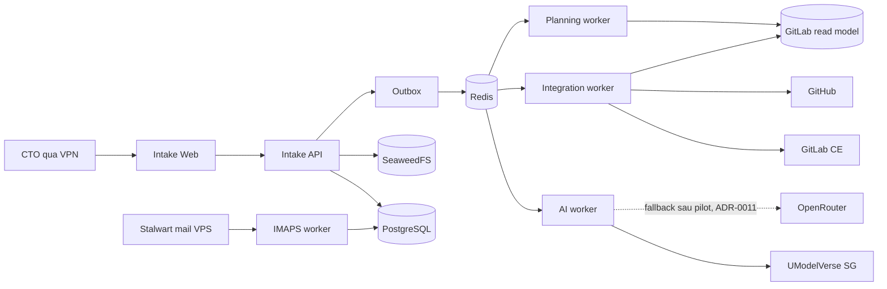

English | [Tiếng Việt](system-overview.vi.md)

# System architecture 1.2

_Target architecture + runtime snapshot 2026-10-01_

## 1. Objectives

Intake is a private control plane for intake, normalization, approval, managing internal tasks and coordinating delivery to GitLab/GitHub. Plane has been decommissioned; old links are read-only. The architecture prioritizes audit, idempotency, project separation and recoverability over AI autonomy.

## 2. Components

| Component | Technology | Responsibility |
|---|---|---|
| Web | React/Vite/Nginx | CTO UI, holds no secrets |
| API | FastAPI/Python | Auth, validation, transactions, queries and review |
| PostgreSQL | PostgreSQL | Source of truth for business/job/audit data |
| Redis | Redis | Celery broker, not a durable source |
| Dispatcher | Python worker | Claims the outbox and enqueues IDs |
| AI worker | Celery/Python | Extract/normalize, re-read malformed Daily Reports, create meeting notes; has no external write token |
| Integration worker | Python | GitLab/GitHub sync from the approved snapshot |
| IMAPS worker | Python | Reads the report mailbox read-only |
| Meeting gateway | FastAPI/WebSocket | Forwards audio to ElevenLabs, relays text back with speaker separation, deletes the provider-side copy, purges expired meetings; the only container holding `ELEVENLABS_API_KEY` |
| Planning scheduler | Celery Beat | Emits the schedule for report snapshot/GitLab refresh/Planning Run |
| Planning worker | Celery/Python | Creates the report snapshot and Planning Run, holds no external token |
| Object storage | SeaweedFS S3 gateway | Quarantine/trusted binary |

## 3. Context



## 4. Trust boundaries

- The browser only calls the Intake API through the reverse proxy.
- PostgreSQL, Redis and SeaweedFS live only on the Docker internal network.
- The AI worker only goes outbound to allowlisted AI endpoints.
- Only the integration worker has GitLab/GitHub write tokens.
- The planning worker/scheduler only reads PostgreSQL/Redis; the 06:45 checkpoint routes the read-only GitLab refresh to the integration worker.
- The IMAPS worker only has mailbox read credentials and is blocked from outbound SMTP.
- GitLab/Intake are not exposed to the Internet; users access them via VPN.

## 5. Reliability patterns

- Transactional outbox prevents losing work between DB commit and queue publish.
- Idempotency keys protect external side effects.
- Lease + `SKIP LOCKED` prevents two workers from claiming the same item.
- Exponential backoff with jitter for transient errors.
- Dead/terminal states are shown to the CTO; no infinite retries.
- Queue payloads contain only identifiers, no raw binary/content.

## 6. Module boundaries

```text
identity       authentication, MFA, sessions, authorization
catalog        customers, projects, integration mappings
intake         source, attachments, normalized item
processing     outbox, runs, evidence, AI extraction
workflow       review, approval actions, snapshots
integrations   GitLab, GitHub, IMAPS adapters and sync jobs
reporting      daily/weekly internal report
planning       workforce, capacity, GitLab read model, run/candidate/assignment, planning approval/sync
audit          append-only security/business audit
operations     health, metrics, retention, backup hooks
```

Modules communicate only through service contracts or versioned events; they do not access another module's tables with ad hoc queries.

