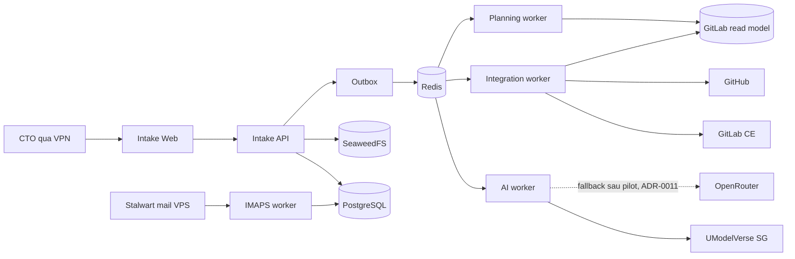

[English](system-overview.md) | Tiếng Việt

# Kiến trúc hệ thống 1.2

_Target architecture + runtime snapshot 2026-10-01_

## 1. Mục tiêu

Intake là control plane riêng tư cho việc tiếp nhận, chuẩn hóa, phê duyệt, quản lý việc nội bộ và điều phối delivery sang GitLab/GitHub. Plane đã ngừng vận hành; link cũ chỉ đọc. Kiến trúc ưu tiên audit, idempotency, tách project và khả năng khôi phục hơn tự chủ AI.

## 2. Thành phần

| Thành phần | Công nghệ | Trách nhiệm |
|---|---|---|
| Web | React/Vite/Nginx | UI CTO, không giữ secret |
| API | FastAPI/Python | Auth, validation, transaction, query và review |
| PostgreSQL | PostgreSQL | Nguồn sự thật nghiệp vụ/job/audit |
| Redis | Redis | Celery broker, không phải nguồn bền vững |
| Dispatcher | Python worker | Claim outbox và enqueue ID |
| AI worker | Celery/Python | Extract/normalize, đọc lại Daily Report sai mẫu, tạo meeting note; không có external write token |
| Integration worker | Python | GitLab/GitHub sync từ approved snapshot |
| IMAPS worker | Python | Đọc report mailbox read-only |
| Meeting gateway | FastAPI/WebSocket | Chuyển tiếp audio tới ElevenLabs, chuyển chữ lại có tách người nói, xóa bản sao phía nhà cung cấp, purge cuộc họp hết hạn; container duy nhất giữ `ELEVENLABS_API_KEY` |
| Planning scheduler | Celery Beat | Phát lịch report snapshot/GitLab refresh/Planning Run |
| Planning worker | Celery/Python | Tạo snapshot report và Planning Run, không giữ external token |
| Object storage | SeaweedFS S3 gateway | Quarantine/trusted binary |

## 3. Context



## 4. Trust boundaries

- Browser chỉ gọi Intake API qua reverse proxy.
- PostgreSQL, Redis và SeaweedFS chỉ ở Docker internal network.
- AI worker chỉ outbound tới allowlisted AI endpoints.
- Integration worker mới có token GitLab/GitHub write.
- Planning worker/scheduler chỉ đọc PostgreSQL/Redis; mốc 06:45 route read-only GitLab refresh sang integration worker.
- IMAPS worker chỉ có credential đọc mailbox và bị chặn outbound SMTP.
- GitLab/Intake không công khai ra Internet; truy cập người dùng qua VPN.

## 5. Reliability patterns

- Transactional outbox chống mất việc giữa DB commit và queue publish.
- Idempotency key bảo vệ side effect bên ngoài.
- Lease + `SKIP LOCKED` chống hai worker cùng claim.
- Exponential backoff có jitter cho lỗi transient.
- Dead/terminal state hiển thị cho CTO; không retry vô hạn.
- Payload queue chỉ có identifier, không có raw binary/content.

## 6. Ranh giới module

```text
identity       authentication, MFA, sessions, authorization
catalog        customers, projects, integration mappings
intake         source, attachments, normalized item
processing     outbox, runs, evidence, AI extraction
workflow       review, approval actions, snapshots
integrations   GitLab, GitHub, IMAPS adapters and sync jobs
reporting      daily/weekly internal report
planning       workforce, capacity, GitLab read model, run/candidate/assignment, planning approval/sync
audit          append-only security/business audit
operations     health, metrics, retention, backup hooks
```

Module chỉ giao tiếp qua service contract hoặc event có version; không truy cập table của module khác bằng query tùy tiện.
