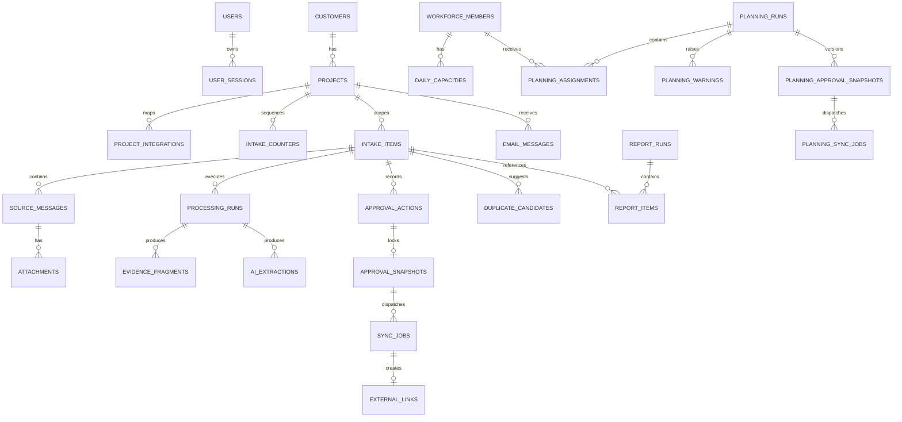

English | [Tiếng Việt](data-model.vi.md)

# Data model - Private Feedback Intake

_Target + runtime schema 1.2 | PostgreSQL baseline reconciled on 2026-10-01_

## 1. Document status

The PostgreSQL baseline schema has been deployed and the pilot volume has been reset in a controlled way. The runtime currently has 33 ORM tables; PostgreSQL uses UUID, JSONB, TIMESTAMPTZ and CITEXT according to the migrations in `app/migrations/postgresql/`. SQLite is used only for test isolation, so type/locking/index behavior must continue to be verified on PostgreSQL.

The description below records both target invariants and runtime. Targets without code are clearly marked; for inventory and evidence see `IMPLEMENTATION-INVENTORY.md` and `PRODUCTION-READINESS.md`.

## 2. Conventions

- Primary keys use PostgreSQL `UUID`, default `gen_random_uuid()`.
- Display IDs use `public_id`, which is not used as a foreign key. Old records keep the `FB-2026-*` code; new records use `{PROJECT_KEY}-{YY}W{ISO_WEEK}-{SEQUENCE}`, for example `SAV-26W40-001`.
- Weeks follow ISO-8601, starting on Monday; the moment an ID is issued is converted to `Asia/Ho_Chi_Minh`.
- Timestamps use `TIMESTAMPTZ`, stored in UTC and formatted by timezone in the UI.
- Flexible JSON uses `JSONB`; fields that need filter, sort, join or constraint must be separate columns.
- `confidence` and `score` use `DOUBLE PRECISION`, limited to `0..1`.
- Business enums use `TEXT` + `CHECK` during the pilot so migrations are easy to control.
- Binaries are not stored in PostgreSQL; they are stored in SeaweedFS and the `object_key` is kept.
- Every multi-project business table must have a trace path to `project_id`.
- Deleting raw data by retention is a hard purge with audit; other business data prefers state transitions or soft delete.

## 3. Relationship diagram



## 4. Identity and catalog

### 4.1 `users`

| Column | Type | Constraint |
|---|---|---|
| `id` | UUID | PK |
| `email` | CITEXT | UNIQUE, NOT NULL |
| `display_name` | VARCHAR(255) | NOT NULL |
| `role` | VARCHAR(32) | CHECK `CTO`, `PROJECT_OWNER`; in the pilot only the CTO is active |
| `password_hash` | TEXT | NOT NULL |
| `auth_version` | INTEGER | NOT NULL DEFAULT 0; embedded in the session and incremented when a password is issued/reset or MFA changes, to invalidate old sessions |
| `mfa_secret_ciphertext` | TEXT | nullable until setup |
| `mfa_pending_secret_ciphertext` | TEXT | nullable; enrollment secret awaiting confirmation, does not replace the active factor |
| `mfa_pending_expires_at` | TIMESTAMPTZ | nullable; an enrollment awaiting confirmation expires after 10 minutes |
| `mfa_enabled` | BOOLEAN | NOT NULL DEFAULT false |
| `is_active` | BOOLEAN | NOT NULL DEFAULT true |
| `created_at`, `updated_at` | TIMESTAMPTZ | NOT NULL |

Recovery codes are not stored in plaintext. Use the table `mfa_recovery_codes(user_id, code_hash, used_at, created_at)` with unique `(user_id, code_hash)`. Replacing MFA or regenerating recovery codes requires step-up with the current password and an OTP from the active factor. Confirming MFA changes `mfa_secret_ciphertext` in the same transaction, increments `auth_version` and revokes personal tokens.

### 4.1A `password_reset_requests` (INT-26W43-009, migration 058)

`password_reset_requests(id, user_id, token_hash, expires_at, used_at, sent_at, send_error, created_at)` stores only the SHA-256 of the Mailgun token. The token expires by default after 30 minutes and is single-use; a new request invalidates the old one. No reset token, password or email content is stored in audit.

### 4.1B `user_project_access` (ADR-0022)

Primary key `(user_id, project_id)`, with `granted_by` and `created_at`. A row means that Project Owner may work in that project. The CTO needs no row. `users.must_change_password` is set when the CTO issues a temporary password and cleared when the user changes it themselves.

From ADR-0023: `projects.owner_member_id` points to the member who is the sole Project Owner of the project (null when there is none); `users.member_id` (unique) links the account to a member. `user_project_access` is now written only when a project's Owner changes. From ADR-0058: `users.role` also accepts `DEVELOPER` (an account linked to a member, projects derived from `workforce_project_memberships`, no `user_project_access` row); `planning_assignments` adds `work_status` (PLANNED, IN_PROGRESS, DONE, BLOCKED), `work_status_at`, `work_status_note`, written by the assignee via MCP (migration 035). From FR-PLAN-37 (2026-10-19) `users.member_id` of the CTO account points to the CTO's own member profile (created via `POST /planning/members/me` or linked by email when creating a member); that profile defaults to 0 hours, is not asked for a Daily Report, and can be `projects.owner_member_id` without a separate Project Owner account. No new columns.

### 4.1C `user_hint_dismissals`, `hint_opens` (FR-UI-17, migration 049)

`user_hint_dismissals(user_id, key, dismissed_at)` with primary key `(user_id, key)`: page introductions already read. `hint_opens(id, user_id, key, opened_at)`: each time a hint is opened, for weekly counts.

### 4.2 `user_sessions`

Stores `token_hash`, `user_id`, `expires_at`, `revoked_at`, `last_seen_at`, `ip_hash` and `user_agent_hash`. Partial index on sessions that are not revoked and not expired.

### 4.3 `customers`

`id`, `code`, `name`, `status`, `metadata JSONB`, timestamps. `code` is unique, case-insensitive.

### 4.4 `projects`

| Column | Type | Notes |
|---|---|---|
| `id` | UUID | PK |
| `customer_id` | UUID | FK nullable |
| `code` | CITEXT | UNIQUE; `orbit`, `ember` |
| `intake_key` | VARCHAR(8) | UNIQUE, NOT NULL; `SAV`, `KIN` |
| `name` | VARCHAR(255) | NOT NULL |
| `status` | VARCHAR(32) | `ACTIVE`, `INACTIVE` |
| `settings` | JSONB | Only configuration not used for security routing |
| timestamps | TIMESTAMPTZ | NOT NULL |

`kind` (ADR-0020): `IDEA`, `NON_CODE` or `SOFTWARE`, default `SOFTWARE`. Determines which links are required and whether the project enters Daily Planning.

### 4.5 `project_integrations`

One record per `(project_id, system)`.

| Column | Type | Notes |
|---|---|---|
| `project_id` | UUID | FK |
| `system` | VARCHAR(32) | `GITLAB`, `GITHUB`; `PLANE` mappings were removed by migration 057 |
| `base_url` | TEXT | Allowlisted HTTPS URL |
| `workspace_external_id` | TEXT | schema compatibility field; not used by the current runtime |
| `project_external_id` | TEXT | GitLab path or GitHub repository |
| `credential_ref` | TEXT | Secret name, does not contain the secret |
| `enabled` | BOOLEAN | false for mappings not yet confirmed |
| `config` | JSONB | Non-sensitive label/workflow mapping |

Unique `(project_id, system)`.

From ADR-0021 `system` also accepts `GITHUB`: `project_external_id` is `chủ-sở-hữu/repository` (owner/repository), `credential_ref` is the variable name `GITHUB_TOKEN_<TÊN>` (`<NAME>`), `config` holds the URL, repository name and `issue_style = MINIMAL`. A project has at most one of the two links `GITLAB`/`GITHUB`.

### 4.5B `project_context_snapshots` (ADR-0063)

One row per project: `project_id` (unique), `source` (`REPO` | `PASTED`), `path`, `sha` (blob id or sha of the file), `content` (up to 60 KB), `meta` JSON (`project`, `owner`, `updated`), `sections` JSON (each item: number, name, required, sent to AI, present, line count), `score`, `band`, `missing` JSON, `stale_days`, `error` (error code of the most recent read, does not delete the previous good version), `fetched_at`, `approved_sha`, `approved_by`, `approved_at`, timestamps. Migration 042.

### 4.5C `project_context_suggestions` (ADR-0063, FR-CTX-04)

One row per suggestion for the context pack written by an agent or a person via `log_work.context_suggestions`: `project_id`, `intake_id` (SET NULL when the request is deleted), `work_log_id` (→ `intake_work_log`), `text` (up to 500 characters), `suggested_by`, `agent_name`, `status` (`PENDING` | `APPLIED` | `DISMISSED`), `decided_by`, `decided_at`, `created_at`. Index `(project_id, status)`. Intake does not edit the context pack file: `APPLIED` means the CTO edited it in the repo themselves. Migration 043.

### 4.5A `integration_probes`

GitLab/GitHub listing or check requests performed by the integration worker: `system` (`GITLAB`, `GITHUB`); `action` (`LIST`, `CHECK`, `MEMBERS`, `TOKENS`), `reference` (for GitHub in the form `TÊN_BIẾN_TOKEN|chủ-sở-hữu/repository`, i.e. token variable name|owner/repository), `status`, `result JSONB`, `error_code`, actor and timestamps. Migration 057 removes old Plane probes because this is temporary configuration, not business history.

### 4.6 `intake_counters`

Keeps an independent sequence per `(project_id, iso_year, iso_week)`. Numbers are issued by an atomic upsert in the same transaction that creates the Intake; `last_value` is limited to `1..999`. This structure avoids scanning `intake_items` and avoids duplicate IDs when many requests run concurrently.

## 5. Intake and source

### 5.1 `intake_items`

Main columns: `id`, `public_id`, `project_id`, `customer_id`, `channel`, `item_type`, `status`, `normalized_title`, `normalized_summary`, `suggested_priority`, `approved_priority`, `proposed_route`, `approved_route`, `current_extraction_id`, `duplicate_of_id`, `defer_until`, `version`, `created_by`, timestamps.

Allowlisted states:

```text
NEW, QUEUED, PROCESSING, REVIEW_REQUIRED, APPROVED,
SYNC_PENDING, SYNCED, REJECTED, DEFERRED, NEEDS_INFORMATION, FAILED
```

`version` increments on every mutation that affects review/sync.

### 5.2 `source_messages`

| Column | Type | Notes |
|---|---|---|
| `intake_id` | UUID | FK |
| `channel` | VARCHAR(32) | ZALO, WHATSAPP, EMAIL, MEETING, MANUAL |
| `external_message_id` | TEXT | nullable |
| `sender_reference_ciphertext` | TEXT | encrypted |
| `raw_content_ciphertext` | TEXT | encrypted |
| `content_hash` | CHAR(64) | SHA-256 of canonical content |
| `raw_payload` | JSONB | allowlisted provider metadata |
| `received_at`, `created_at`, `purge_after` | TIMESTAMPTZ | retention |
| `purged_at` | TIMESTAMPTZ | nullable |

Partial unique on `(channel, external_message_id)` when the external ID has a value and has a matching project/intake scope.

### 5.3 `attachments`

`intake_id`, `source_message_id`, `object_key`, `original_name_ciphertext`, `declared_mime_type`, `detected_mime_type`, `size_bytes BIGINT`, `sha256`, `storage_state`, `scan_status`, `ocr_status`, `ocr_text_ciphertext`, `ocr_model`, `ocr_at`, `ocr_error`, `page_count` (migration 040, FR-AI-14), `purge_after`, timestamps.

`object_key` is unique. `scan_status=CLEAN` and `storage_state=TRUSTED` are set when the file passes pre-processing checks (magic bytes, size, PDF without password, no embedded files), not as a malware scan result (ADR-0015); a broken file is marked `scan_status=REJECTED`. `ocr_status`: `NONE` not read yet, `RUNNING`, `RETRY` (model did not respond, read again later), `DONE`, `FAILED`, `REJECTED`, `SKIPPED` (image reading turned off); `ocr_text_ciphertext` is the text the vision model read, encrypted like raw content (ADR-0061); `ocr_error` is an error code or `PARTIAL` when the PDF is longer than the page limit.

### 5.4 `feedback_items` (ADR-0064, FR-FBK-01..03)

Member feedback before it becomes an Intake: `project_id`, `member_id` (member, SET NULL on delete), `user_id` (account, if any), `transport` (`WEB` | `TELEGRAM` | `AGENT`), `text_ciphertext` (encrypted like raw content), `status` (`PENDING` | `ACCEPTED` | `REJECTED`), `intake_id` (Intake created on acceptance, SET NULL when the Intake is deleted), `decided_by`, `decided_at`, `decision_note`, `idempotency_key_hash` (unique; Telegram `telegram:<chat>:<message>`, MCP `mcp:<user>:<key>`), `created_at`. Indexes `(project_id, status, created_at)` and `(status, decided_at)`. Migration 044.

### 5.5 `feedback_files` (ADR-0064)

Files of a feedback item: `feedback_id` (CASCADE), `object_key` unique (`feedback/<id>/<hex>` in object storage), `name_ciphertext`, `mime_type` (magic bytes checked), `size_bytes`, `sha256`, `created_at`. On acceptance, the bytes are copied into `attachments` of the new Intake; the rows here are kept so the person who gave feedback can review them.

### 5.6 `work_items` (ADR-0066, FR-WRK-01..06)

Internal tasks of a project, replacing work items on Plane: `id`, `project_id`, `seq` (increments per project, `UNIQUE (project_id, seq)`), `code` (`{intake_key}-W-{seq}`, unique), `title`, `description_ciphertext` (Fernet like request content), `status` (`DISCUSS`, `READY`, `IN_PROGRESS`, `ACCEPTANCE`, `DONE`, `CANCELLED`), `priority` (`P0..P3`), `member_id` (assignee, `SET NULL`), `due_date`, `intake_id` (originating request, `SET NULL`), `issue_system`, `issue_external_id`, `issue_url` (once it has become an Issue), `outcome` (`NULL`, `ISSUE_PENDING`, `ISSUE`), `closed_note` (reason for Drop ("Bỏ") or note for Done ("Xong")), `created_by`, `version`, `parent_id` (parent task, `SET NULL`), `template` (`VIDEO`), `step`, `step_order`, `evidence_required` (migration 048, FR-WRK-08), `created_at`, `updated_at`, `closed_at`. The history of column changes, edits and comments is in `audit_events` with `entity_type = 'work'`.

### 5.7 `work_comments` (ADR-0066, FR-WRK-04)

`id`, `work_id` (CASCADE), `user_id`, `body_ciphertext`, `created_at`.

### 5.8 `work_links` (ADR-0066, FR-WRK-07, migration 047)

`id`, `work_id` (CASCADE), `url`, `note`, `source` (`USER`, `AGENT`), `added_by`, `created_at`.

### 5.9 Posts: extra columns on `work_items`, `work_channels`, `channel_rules` (ADR-0067, FR-MKT-01..02, migration 051)

`work_items` adds `channel` (main channel), `format` (`POST`, `IMAGE`, `VIDEO`, `LONGFORM`, `EMAIL`), `campaign` (label, 80 characters), `urgent` (Urgent ("Gấp")); `status` also accepts `APPROVED`.

`work_channels(id, work_id CASCADE, channel, publish_at, status DRAFT|READY|PUBLISHED, published_url, language, created_at, updated_at)`, `UNIQUE (work_id, channel)`, index `(channel, publish_at)`: one channel version of a post.

`channel_rules(code PK, label, language, max_chars, recommended_chars, long_max_chars, max_images, image_ratio, video_ratio, hashtag_max, link_counts_chars, link_chars, best_hours JSON, tone, enabled, sort_order, updated_by, updated_at)`: channel rules, seeded with 12 rows, edited by the CTO.

### 5.10 Social listening and measurement for marketing projects (ADR-0068, FR-MKT-08..12, migration 052)

`watch_signals` adds `via` (`api`, `scrape`, `agent` from migration 053) and `priority` (`high`, `normal`). Marketing projects share `watch_sources`, `watch_signals`, `watch_contacts`, `watch_checks` with the `content` stream; pillars are in `projects.project_settings.pillars` (a list of objects) and collection settings are in `project_settings.watch`.

`watch_platforms(code PK, label, enabled, via api|scrape|none, note, sort_order, updated_by, updated_at)`: channels the CTO opens to the scanning tool, seeded with 9 rows.

`app_settings(key PK, value JSON, updated_by, updated_at)`: system-wide settings by key; the first key is `watch.max_ai_runs_per_day`.

`watch_topics(id, project_id, week_start, key, title, why, angles JSON, channels JSON, caution, pillar, score, signal_ids JSON, state NEW|USED|DISMISSED, work_id SET NULL, ai_written, created_at, updated_at)`, `UNIQUE (project_id, week_start, key)`, index `(project_id, state, score)`: one hot topic of one week.

`work_channels` adds `text` (the text of the channel version).

`post_links(id, work_channel_id CASCADE UNIQUE, code UNIQUE, target_url, created_by, created_at)` and `post_clicks(id, link_id CASCADE, at, referrer_host, is_bot)`, index `(link_id, at)`: the short link of a channel version and each click, without storing the clicker's address.

`watch_connectors(id, project_id, name, kind GENERIC|N8N|MAKE|APIFY|MENTION, token_hash, token_prefix, via api|scrape, default_pillar, mapping JSON, enabled, received_count, rejected_count, last_received_at, last_status, created_by, created_at, updated_at)` (migration 054): an inbound gateway for external services; `watch_deliveries(id, connector_id CASCADE, at, status ACCEPTED|EMPTY|INVALID|UNAUTHORIZED, accepted, duplicates, rejected, note)`: the 30 most recent calls of each gateway.

`channel_rules` adds `auto_publish` (migration 054); `app_settings` adds the key `publish.paused`.


## 6. Processing and AI

### 6.1 `processing_runs`

| Column | Type | Notes |
|---|---|---|
| `id` | UUID | PK |
| `intake_id`, `parent_run_id` | UUID | FK |
| `run_type`, `stage` | VARCHAR(32) | NORMALIZE, SCAN, OCR, VISION, EVIDENCE |
| `job_key` | VARCHAR(255) | UNIQUE idempotency key |
| `status` | VARCHAR(32) | QUEUED, RUNNING, RETRY, SUCCEEDED, PARTIAL, FAILED, CANCELLED |
| `attempt`, `max_attempts` | INTEGER | CHECK non-negative |
| `input_hash`, `output_hash` | CHAR(64) | nullable |
| `retryable` | BOOLEAN | NOT NULL |
| `next_attempt_at`, `lease_expires_at` | TIMESTAMPTZ | dispatch/lease |
| `run_metadata` | JSONB | provider-neutral metadata |
| timestamps/error fields | TIMESTAMPTZ/TEXT | errors must be redacted |

### 6.2 `evidence_fragments`

Stores `processing_run_id`, `attachment_id`, `source_message_id`, `page_number`, `fragment_order`, `content_ciphertext`, `content_hash`, `bounding_box JSONB`, `extractor`, `confidence`, timestamps. No binary/base64 is stored.

### 6.3 `ai_extractions`

Stores `processing_run_id`, `intake_id`, `schema_version`, `prompt_version`, `model_provider`, `model_name`, `input_policy`, `result JSONB`, `confidence DOUBLE PRECISION`, `token_usage JSONB`, `fallback_reason`, `latency_ms`, `created_at`.

`result` must match the schema version before insert. Commonly filtered fields are not read directly from JSONB; they are materialized onto `intake_items` after deterministic validation.

Runtime 1.2 validates/materializes only five fields: `item_type`, `suggested_priority`, `proposed_route`, `normalized_title`, `normalized_summary`. Acceptance criteria, missing information, risks, evidence refs, confidence and full token usage are still target schema; the trace columns exist but not every field is filled by the provider adapter.

### 6.4 `duplicate_candidates`

`intake_id`, `candidate_type`, `candidate_reference`, `match_method`, `score`, `decision`, `decided_by`, timestamps. Unique `(intake_id, candidate_type, candidate_reference)`.

## 7. Approval and integration

### 7.1 `approval_actions`

`source` also accepts `WORK` from migration 046: re-deciding a request on the `WORK` route to a delivery target when "Create Issue" ("Tạo Issue") is clicked from an internal task (ADR-0066); and `MEETING` from migration 050: a meeting minutes item goes straight to the Tasks board (FR-REC-19).

Append-only: `intake_id`, `actor_id`, `action`, `reason`, `item_version`, `created_at`.

### 7.2 `approval_snapshots`

Immutable: `approval_action_id`, `intake_id`, `project_id`, `item_version`, `approved_route`, `payload JSONB`, `payload_hash`, `invalidated_at`, `created_at`.

A snapshot is synced only when it is not invalidated, the item version matches and the route/mapping is valid.

### 7.3 `sync_jobs`

`approval_snapshot_id`, `intake_id`, `project_id`, `target_system`, `status`, `idempotency_key`, `attempt`, `max_attempts`, `next_attempt_at`, `lease_expires_at`, `request_payload_hash`, `response_metadata JSONB`, error fields and timestamps.

Unique `idempotency_key`. Do not derive the key from the request ID; the key must represent the exact external side effect.

### 7.4 `external_links`

`sync_job_id`, `intake_id`, `project_id`, `target_system`, `external_id`, `url`, `payload_hash`, `created_at`. Unique `(project_id, target_system, external_id)` and one success link per sync job.

### 7.5 `outbox_events`

`aggregate_type`, `aggregate_id`, `project_id`, `event_type`, `payload JSONB`, `status`, `dedupe_key`, `attempt`, `next_attempt_at`, `lease_expires_at`, `published_at`, error and timestamps. The payload contains only IDs/small metadata, no raw binary.

## 8. Workforce and daily planning

### 8.1 `workforce_members`

Members who are planned do not need an Intake login account. The table stores `id`, `display_name`, `email_reference`, `status`, `timezone`, `default_weekday_hours`, timestamps. Per-project mapping is in `workforce_project_memberships(member_id, project_id, gitlab_user_external_id, role, active, timestamps)` with unique `(member_id, project_id)`.

`gitlab_user_external_id` is the identifier used for planning sync, not derived from the display name. A missing mapping makes the assignment fail closed on approve.

### 8.2 `daily_capacities`

| Column | Type | Notes |
|---|---|---|
| `member_id` | UUID | FK workforce member |
| `work_date` | DATE | Date in `Asia/Ho_Chi_Minh` |
| `base_hours` | NUMERIC(4,2) | Default 8 on weekdays, 0 on weekends |
| `override_hours` | NUMERIC(4,2) | Nullable; CTO enters OT/changes |
| `meeting_hours` | NUMERIC(4,2) | Default 0 |
| `review_hours` | NUMERIC(4,2) | Default 0 |
| `support_hours` | NUMERIC(4,2) | Default 0 |
| `fixed_hours` | NUMERIC(4,2) | Other fixed activities |
| `available_hours` | NUMERIC(4,2) | Validated materialized value |
| `override_reason` | TEXT | Required for override/OT |
| `version`, `updated_by`, timestamps | | Optimistic concurrency + audit |

Unique `(member_id, work_date)`. Every hour value must be `>= 0`; total deductions must not make `available_hours < 0`. A weekend without a record is still understood as 0 hours, not 8 hours.

### 8.3 `user_planning_project_orders`

Project order preference in the Daily Planning overview, one row per account: `user_id` is the primary key and FK to `users` with `ON DELETE CASCADE`; `sort_mode` accepts only `PRIORITY` or `CUSTOM`; `project_ids JSONB` is an array of project IDs in the order the user saved; `updated_at` is `TIMESTAMPTZ`. `PRIORITY` mode stores an empty array. The service accepts and returns only active software projects within the account's current scope; revoked access does not expose saved IDs in the API.

### 8.4 `planning_runs`

Columns: `id`, `plan_date`, `timezone`, `scope_hash`, `status`, `version`, `source_snapshot_at`, `report_cutoff_at`, `gitlab_snapshot_at`, `supersedes_run_id`, `created_by`, timestamps.

State allowlist:

```text
DRAFT, REVIEW_REQUIRED, APPROVED, SYNCING, SYNCED,
PARTIAL, SYNC_FAILED, SUPERSEDED
```

Database unique on `(plan_date, scope_hash, revision)`; the runtime service returns the existing non-`SUPERSEDED` run for the same date/scope. The target amendment creates a new revision for the whole run, linked via `supersedes_run_id`, keeps the old snapshot immutable and computes a per-Issue delta for the new snapshot; runtime 1.2 has no amendment/supersede API yet and an approved run cannot be edited.

### 8.5 `planning_assignments`

| Column | Type | Notes |
|---|---|---|
| `planning_run_id`, `project_id`, `member_id` | UUID | Scope and assignee |
| `slot` | TEXT | `MORNING`, `AFTERNOON` |
| `work_type` | TEXT | `DEVELOPMENT`, `REVIEW`, `QA`, `SUPPORT`, `MEETING`, `FIXED` |
| `is_primary` | BOOLEAN | Only the main development task uses true |
| `planned_hours` | NUMERIC(4,2) | > 0 |
| `source_type`, `source_reference` | TEXT | GitLab/Intake/Plane/report trace |
| `gitlab_issue_external_id` | TEXT | Required for development/review/QA delivery |
| `proposed_priority`, `approved_priority` | TEXT | P0-P3 |
| `proposed_assignee_external_id`, `approved_assignee_external_id` | TEXT | GitLab user ID |
| `proposed_milestone_external_id`, `approved_milestone_external_id` | TEXT | Milestone must exist |
| `proposed_due_date`, `approved_due_date` | DATE | GitLab accepts dates only |
| `dependency_state`, `source_state` | TEXT | Snapshot for validation |
| `override_reason` | TEXT | CTO exception |
| `version`, timestamps | | Optimistic concurrency |

Constraint/application validation ensures total hours per member/slot do not exceed available capacity without a CTO override; each member/run has at most one distinct primary development Issue in the Doing state without an override.

### 8.6 `planning_candidates`

Quick Add and Daily Report store candidates before they become assignments: `planning_run_id`, `project_id`, optional `member_id/intake_id/assignment_id`, `source_type`, `source_reference`, optional GitLab/Plane reference, sanitized title/summary, `status`, proposed priority, requested hours/slot, idempotency hash, actor and timestamps.

State allowlist: `PENDING_TRIAGE`, `READY`, `ASSIGNED`, `REJECTED` (postponed today, or replaced by a duplicate row), `DONE_ELSEWHERE` (already done outside the plan, awaiting acceptance; migration 055, from 2026-10-19). `FORM` and `PASTE` always create a new Intake and start at `PENDING_TRIAGE`; only an open GitLab Issue in the read model may be promoted to a proposal assignment. A candidate is not a source for direct GitLab sync.

`source_type` allowlist: `GITLAB`, `INTAKE`, `PLANE`, `FORM`, `PASTE`, `REPORT`, `VERIFICATION` (a task rejected during sample verification, ADR-0045). A `REPORT` candidate (ADR-0019) is generated from an unfinished task in a Daily Report: it has `member_id` set to the reporter, `source_reference = "Daily Report YYYY-MM-DD"`, no `intake_id`, and an idempotency key per run + report item. If there is an open Issue it is `READY`, otherwise `PENDING_TRIAGE`.

### 8.7 `planning_warnings`

Stores `planning_run_id`, optional `assignment_id/member_id/project_id`, `code`, `severity`, `source_values JSONB`, `message`, `acknowledged_by`, `acknowledged_at`, timestamps. Runtime codes include `REPORT_IDENTITY_UNMAPPED`, `REPORT_MISSING`, `REPORT_MALFORMED`, `REPORT_LATE`, `REPORT_BLOCKER`, `GITLAB_REFERENCE_NOT_FOUND`, `EMAIL_DONE_GITLAB_OPEN`, `EMAIL_ACTIVE_GITLAB_CLOSED`, `GITLAB_MILESTONE_MISSING` and `GITLAB_DUE_DATE_MISSING`. Capacity/WIP/mapping violations currently return an error code on mutate/approve; the target may materialize additional warnings if UI acknowledgement is needed. Per ADR-0013, `GITLAB_MILESTONE_MISSING` and `GITLAB_DUE_DATE_MISSING` are warnings the CTO must acknowledge before approval, not blocking approval; runtime 1.2 still fails closed.

Do not store raw email/chat in `source_values`; store only references and sanitized values.

### 8.8 `planning_approval_snapshots`

Immutable: `planning_run_id`, `run_version`, `approved_by`, `approved_at`, `payload JSONB`, `payload_hash`, `warning_acknowledgements JSONB`, `override_reason`, timestamps. The snapshot contains the exact assignee/milestone/due date and the approved slot/hour plan, no raw source.

### 8.9 `planning_sync_jobs`

One record per `(planning_snapshot_id, project_id, gitlab_issue_external_id)`: `status`, `idempotency_key`, `request_payload_hash`, `before_state JSONB`, `after_state JSONB`, `attempt`, `max_attempts`, `next_attempt_at`, `lease_expires_at`, redacted error and timestamps.

Unique `idempotency_key`. `before_state`/`after_state` contain only assignee, milestone, due date and allowlisted identifiers. The worker claims `PENDING`/`RETRY`; a manual retry only moves a `FAILED` job with remaining attempt budget back to `PENDING`, creates an idempotent outbox event and an audit entry. A `PARTIAL` run does not roll back `SUCCEEDED` jobs.

### 8.10 `issue_verifications` (ADR-0045, ADR-0055)

From 2026-10-15 (migration 041) adds `source_note`: the note entered when clicking "Cancel" ("Hủy") on a pending already-done task, copied onto the Issue when the CTO accepts (FR-PLAN-34).

One row per Issue put up for acceptance: `project_id`, `issue_external_id`, `planning_run_id` (nullable from ADR-0055), `evidence_level`, `decision` (CTO: PENDING/ACCEPTED/REJECTED), `reason`, `decided_by`, `decided_at`; from ADR-0055 adds `source` (`REPORT` | `CLOSED`), `report_item_id`, `member_id`, `reported_on`, `picked_on` (date it entered the CTO's daily sample), `po_decision`, `po_reason`, `po_decided_by`, `po_decided_at`, `sync_status` (PENDING, RETRY, DONE, FAILED, SKIPPED, QUEUE_FAILED), `sync_error`, `synced_at`. One row per Issue.

### 8.Z `issue_evidence_links` (ADR-0065, FR-PLAN-36)

Evidence attached by people to an Issue: `project_id`, `issue_external_id`, `kind` (`COMMIT` | `MR` | `LINK`), `url` (up to 1000), `ref` (SHA or short name when there is no link), `note`, `source` (`WORKER` | `ACCEPTOR` | `AGENT` | `WORK_LOG` | `REPORT`), `added_by` (account), `member_id` (member, SET NULL), `created_at`. Index `(project_id, issue_external_id, created_at)`; the same `url` or `ref` on one Issue is recorded only once. `issue_verifications` adds `evidence_missing_reason` (reason for still confirming when evidence is missing). Migration 045.

## 9. Email, report and audit

### 9.1 `email_messages`

`project_id` nullable when an email covers multiple projects, `member_id`, `supersedes_email_id`, `mailbox`, `uid_validity`, `uid`, `message_id`, sender, `report_date`, subject/body ciphertext, content hash, parser version/errors, status, revision, `is_current`, `is_late`, retention and timestamps. Unique `(mailbox, uid_validity, uid)`; index on Message-ID and `(member_id, report_date, is_current)`.

### 9.2 `report_runs` and `report_items`

`report_runs` has a project or a multi-project scope, period, status and snapshot time. `report_items` links email/revision, project, member, category, work status, title/summary, worked/remaining/planned hours, progress, next step, GitLab/Plane/Intake reference, deadline/dependency, evidence and blocker. Reports do not overwrite GitLab/Plane sources. A reply/update creates a revision linked to the old record; history is not deleted. The 23:30 snapshot attaches the current item revisions to an idempotent `DAILY_REPORT_ALL` run.

From ADR-0054 `report_items` also has `issue_suggestions JSONB` (up to three suggestions `{issue, title, source, confidence, reason?}`), `issue_link_source` (`RULE_PREVIOUS`, `RULE_PLAN`, `RULE_ISSUE`, `RULE_INTAKE`, `AI`, `MANUAL`; null when the Issue number is taken from the text in the email) and `no_issue_reason` (`MEETING`, `SUPPORT`, `REVIEW`, `LEARNING`, `OTHER`).

### 9.3 `audit_events`

Append-only: `project_id`, `actor_type`, `actor_id`, `event_type`, `entity_type`, `entity_id`, `request_id`, `details JSONB`, `created_at`. Do not record raw content, secrets or full prompts.

### 9.4 `gitlab_issue_snapshots`

Immutable read model keyed by `(project_id, issue_external_id, payload_hash)`: title, state, labels, assignee IDs, milestone, due date, URL, external update time, fetch/last-seen time and `is_current`. The integration worker is the only role that calls GitLab with a token; the Planning worker only reads this table. An unchanged payload only updates `last_seen_at`; a changed payload creates a new snapshot and keeps the old history.

### 9.5 `board_daily_snapshots`

Snapshot of each project's start-of-day board at 23:55 (ADR-0053): `snapshot_date`, `project_id`, `readiness_state`, `reports_expected/received/late`, `approvals_pending/cto/overdue`, `waiting`, `waiting_overdue`, `unsynced`, `stuck`, `work_log_pending/overdue`, `p0_open`, `p0_open_overdue`, `plan_status`, `assigned_hours`, `available_hours`, `created_at`. Unique `(snapshot_date, project_id)`; a rerun replaces the row. Derived data, can be recaptured from the source data of the current day (not past days).

### 9.6 Reminders via Telegram (ADR-0057)

`projects` adds `telegram_chat_id`, `telegram_thread_id` (topic in a shared group, null means the whole group), `telegram_chat_title` ("Nhóm › Chủ đề", i.e. "Group › Topic"), `telegram_linked_at`. `workforce_members` adds `telegram_chat_id`, `telegram_username`, `telegram_invite_code` (unique when not null, cleared when used), `telegram_linked_at`. `holidays(day PK, note, created_at)` is the list of days off that the CTO replaces as a whole. `telegram_messages(id, kind, chat_id, thread_id, project_id, member_id, for_date, slot, status SENT|FAILED, error, sent_at, created_at)` unique `(kind, chat_id, thread_id, for_date, slot)` (migration 034 widened the key): each message once, even when sending fails. `telegram_state(key PK, value, updated_at)` holds the long polling offset, the bot username and the last time the bot was alive. Chat id and username are Telegram user identity data, not content; no message text is stored.

### 9.7 Personal tasks (ADR-0060)

`personal_tasks(id, user_id FK users, member_id FK workforce_members nullable, task_date, title, note, hours, start_time HH:MM, remind_at HH:MM, status PLANNED|DONE|SKIPPED, important, urgent nullable (null: by date), rollover_count, archived_at, delegated_member_id, delegated_assignment_id, repeat_rule, repeat_parent_id, done_quadrant, done_at, created_at, updated_at)`; a null `task_date` means not yet scheduled; `status` adds DELEGATED, indexes `(user_id, task_date)` and `(member_id, task_date)`. Belongs to the account; `member_id` is only used to deduct hours and for Telegram reminders. The reminder log is written to `telegram_messages` with `kind = PERSONAL_REMIND`, `slot` being the reminder minute.

## 9A. Meetings (ADR-0018, ADR-0019)

### 9A.1 `meetings`

From migration 029: `series_id` (UUID, null) and `part_number` (int, default 1) link the parts of a meeting recorded beyond the minute limit; part 1 has `series_id` equal to its own `id` when there is a part 2 (ADR-0049).

`project_id` (required at the application layer from 2026-10-05; nullable in the schema because of old meetings), `title`, `status` (`RECORDING`, `FINISHED`, `FAILED`), `source` (`TAB_AND_MIC`, `MIC`, `FILE`), `language`, start/end time, `duration_seconds`, `audio_chunk_count`, `audio_bytes`, `audio_content_type`, `created_by`, retention (`purge_after`, `purged_at`) and timestamps.

Post-meeting processing: `transcript_status` (`NONE`, `PENDING`, `RUNNING`, `DONE`, `FAILED`, `SKIPPED`), `transcript_attempts`, `transcript_claimed_at`, `transcript_error`, `provider_transcription_id`, `provider_deleted_at`; `note_status` (`NONE`, `PENDING`, `DONE`, `FAILED`, `SKIPPED`), `note_attempts`, `note_error`, `note_model`, `note_summary_ciphertext`; `speaker_names JSONB` (label "Thành viên N" ("Member N") -> real name).

Audio is not stored in PostgreSQL: each chunk is encrypted and then stored in object storage with the key `meetings/{id}/audio/{sequence}`.

### 9A.2 `meeting_segments`

One row per speaking turn: `meeting_id`, order, source (`REALTIME` or `BATCH`), `speaker_label`, `start_ms`, `end_ms`, `text_ciphertext`. The `BATCH` version with speakers replaces the `REALTIME` version when post-meeting transcription succeeds.

### 9A.3 `meeting_note_items`

`meeting_id`, `kind` (`DECISION`, `REQUIREMENT`, `BUG`, `SCOPE_CHANGE`, `ACTION`, `QUESTION`, `RISK`), `position`, `title_ciphertext`, `detail_ciphertext`, `owner`, `due_text`, `project_id`, `intake_id`, `edited`, `created_at`. Only `REQUIREMENT`, `BUG`, `SCOPE_CHANGE`, `ACTION` can become an Intake. Items that already have an `intake_id` are not deleted when the note is regenerated and do not change project when the meeting changes project.

### 9A.4 `glossary_terms`

Terms loaded for transcription: `term` (up to 50 characters), `project_id` nullable (null means a shared term), `created_at`; unique per scope + term.

## 9B. First-run setup and GitHub tokens (ADR-0071, ADR-0075, ADR-0076)

### 9B.1 `showcase_enabled` (064)

Sample project and open source catalog items the CTO has enabled (FR-SETUP-15): `item_key` (primary key), `project_id` (the created project, deleted with the project), `catalog_version`, `enabled_by`, `enabled_at`. Disabling only moves the project to `INACTIVE` and keeps this row so that re-enabling restores the same project.

### 9B.2 `github_tokens` (065)

Customer GitHub tokens added by the CTO on screen (FR-INTG-21): `name` (primary key, in the form `GITHUB_TOKEN_<TÊN>`), `token_enc` (encrypted like AI keys), `key_hint` (last 4 characters), `updated_by`, `created_at`, `updated_at`. A project's `credential_ref` points to this row or to an environment variable with the same name; the database row takes precedence.

### 9B.3 AI task `stt` (063)

The CHECK constraint of `ai_routes.task` adds the value `stt` (speech to text, FR-AI-20). This task does not count toward AI being ready during first-run setup.

## 10. Required indexes

```sql
CREATE INDEX ix_intake_project_status_updated
  ON intake_items(project_id, status, updated_at DESC, id DESC);

CREATE INDEX ix_intake_project_created
  ON intake_items(project_id, created_at DESC, id DESC);

CREATE INDEX ix_runs_dispatch
  ON processing_runs(status, next_attempt_at, created_at)
  WHERE status IN ('QUEUED', 'RETRY');

CREATE INDEX ix_outbox_dispatch
  ON outbox_events(status, next_attempt_at, created_at)
  WHERE status IN ('NEW', 'RETRY');

CREATE INDEX ix_sync_dispatch
  ON sync_jobs(status, next_attempt_at, created_at)
  WHERE status IN ('PENDING', 'RETRY');

CREATE INDEX ix_source_purge
  ON source_messages(purge_after)
  WHERE purged_at IS NULL;

CREATE INDEX ix_attachment_purge
  ON attachments(purge_after)
  WHERE purged_at IS NULL;

CREATE UNIQUE INDEX ux_capacity_member_date
  ON daily_capacities(member_id, work_date);

CREATE INDEX ix_planning_run_date_status
  ON planning_runs(plan_date DESC, status, id DESC);

CREATE INDEX ix_planning_assignment_member_slot
  ON planning_assignments(planning_run_id, member_id, slot);

CREATE INDEX ix_planning_candidate_run_status
  ON planning_candidates(planning_run_id, status, created_at);

CREATE INDEX ix_planning_sync_dispatch
  ON planning_sync_jobs(status, next_attempt_at, created_at)
  WHERE status IN ('PENDING', 'RETRY');
```

Do not create a GIN index for every JSONB. Add one only when a real query plan proves it is needed.

## 11. Query performance rules

- Lists use keyset pagination `(updated_at, id)`; no deep offset.
- List projections do not load raw ciphertext, large JSON, audit history or binaries.
- Detail loads relations by batch/selectin; no N+1.
- Dashboards read aggregates or indexed queries; do not scan all of `intake_items` on every page load.
- Background workers claim jobs with `FOR UPDATE SKIP LOCKED` and a lease with a timeout.
- Every list has a default `limit` of 20, maximum 100.

## 12. Current migration/reset

- Gate A and the PostgreSQL rebuild are complete; the pilot volume `intake_postgres-data` was once reset within the correct scope, Redis/SeaweedFS were kept intact.
- The runtime applies the SQL files in order and records `schema_migrations`; an advisory lock serializes cold start when multiple services call `init_db()` at the same time.
- The baseline currently consists of `001_gate_a_baseline.sql`, two independent `002_*` migrations and `003_intake_codes_and_list_ux.sql`.
- From 2026-10-04 the pilot database has real data, so schema changes use additive migrations instead of a reset (OD-032): `004_meeting_capture.sql`, `005_meeting_transcript_and_notes.sql`, `006_report_planning_candidates.sql`, `007_project_kinds_and_integration_probes.sql`, `008_probe_gitlab_members.sql`, `009_github_delivery.sql`, `010_project_owner_access.sql`, `011_project_team.sql`. All eight have run on the pilot database.
- Because the data is still pilot data, the next large ORM change may use a controlled reset instead of a data-conversion migration when the CTO confirms the exact volume/impact. Never delete the volume automatically and do not use `docker compose down -v`.
- The seed currently creates the account schema, `orbit`, `ember` and configuration-driven mappings. Enabling external integrations depends on runtime configuration/credentials, not on the target documents.
