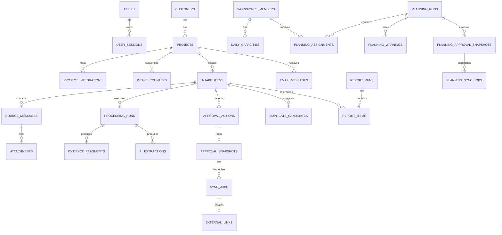

# Data model - Private Feedback Intake

_Target + runtime schema 1.2 | PostgreSQL baseline đối chiếu ngày 2026-10-01_

## 1. Trạng thái tài liệu

Schema PostgreSQL baseline đã được triển khai và pilot volume đã được reset có kiểm soát. Runtime hiện có 33 bảng ORM; PostgreSQL dùng UUID, JSONB, TIMESTAMPTZ và CITEXT theo migration trong `app/migrations/postgresql/`. SQLite chỉ dùng test isolation, vì vậy hành vi type/locking/index phải tiếp tục được kiểm chứng trên PostgreSQL.

Phần mô tả dưới đây vừa ghi target invariant vừa ghi runtime. Target chưa có code được đánh dấu rõ; inventory và evidence xem `IMPLEMENTATION-INVENTORY.md` cùng `PRODUCTION-READINESS.md`.

## 2. Quy ước

- Primary key dùng PostgreSQL `UUID`, mặc định `gen_random_uuid()`.
- ID hiển thị dùng `public_id`, không dùng làm foreign key. Record cũ giữ mã `FB-2026-*`; record mới dùng `{PROJECT_KEY}-{YY}W{ISO_WEEK}-{SEQUENCE}`, ví dụ `SAV-26W40-001`.
- Tuần theo ISO-8601, bắt đầu thứ Hai; thời điểm cấp mã được quy đổi theo `Asia/Ho_Chi_Minh`.
- Thời điểm dùng `TIMESTAMPTZ`, lưu UTC và format theo timezone ở UI.
- JSON linh hoạt dùng `JSONB`; trường cần filter, sort, join hoặc constraint phải là cột riêng.
- `confidence` và `score` dùng `DOUBLE PRECISION`, giới hạn `0..1`.
- Enum nghiệp vụ dùng `TEXT` + `CHECK` ở giai đoạn pilot để migration dễ kiểm soát.
- Binary không lưu trong PostgreSQL; lưu SeaweedFS và giữ `object_key`.
- Mọi bảng nghiệp vụ nhiều dự án phải có đường truy vết tới `project_id`.
- Xóa raw data theo retention là hard purge có audit; dữ liệu nghiệp vụ khác ưu tiên state transition hoặc soft delete.

## 3. Sơ đồ quan hệ



## 4. Identity và catalog

### 4.1 `users`

| Cột | Kiểu | Ràng buộc |
|---|---|---|
| `id` | UUID | PK |
| `email` | CITEXT | UNIQUE, NOT NULL |
| `display_name` | VARCHAR(255) | NOT NULL |
| `role` | VARCHAR(32) | CHECK `CTO`, `PROJECT_OWNER`; pilot chỉ CTO active |
| `password_hash` | TEXT | NOT NULL |
| `auth_version` | INTEGER | NOT NULL DEFAULT 0; được nhúng vào session và tăng khi cấp/reset mật khẩu hoặc đổi MFA để vô hiệu session cũ |
| `mfa_secret_ciphertext` | TEXT | nullable tới khi setup |
| `mfa_pending_secret_ciphertext` | TEXT | nullable; secret enrollment chờ xác nhận, không thay factor đang hoạt động |
| `mfa_pending_expires_at` | TIMESTAMPTZ | nullable; enrollment chờ xác nhận hết hạn sau 10 phút |
| `mfa_enabled` | BOOLEAN | NOT NULL DEFAULT false |
| `is_active` | BOOLEAN | NOT NULL DEFAULT true |
| `created_at`, `updated_at` | TIMESTAMPTZ | NOT NULL |

Recovery code không lưu plaintext. Dùng bảng `mfa_recovery_codes(user_id, code_hash, used_at, created_at)` với unique `(user_id, code_hash)`. Thay MFA hoặc tạo lại recovery code yêu cầu step-up bằng mật khẩu hiện tại và OTP của factor đang hoạt động. Xác nhận MFA đổi `mfa_secret_ciphertext` trong cùng transaction, tăng `auth_version` và thu hồi token cá nhân.

### 4.1A `password_reset_requests` (INT-26W43-009, migration 058)

`password_reset_requests(id, user_id, token_hash, expires_at, used_at, sent_at, send_error, created_at)` lưu duy nhất SHA-256 của token Mailgun. Token hết hạn mặc định 30 phút, một lần; yêu cầu mới vô hiệu yêu cầu cũ. Không lưu reset token, mật khẩu hay nội dung email trong audit.

### 4.1B `user_project_access` (ADR-0022)

Khóa chính `(user_id, project_id)`, kèm `granted_by` và `created_at`. Một dòng nghĩa là Project Owner đó được làm việc trong dự án đó. CTO không cần dòng nào. `users.must_change_password` bật khi CTO cấp mật khẩu tạm và tắt khi người dùng tự đổi.

Từ ADR-0023: `projects.owner_member_id` trỏ tới nhân sự là Project Owner duy nhất của dự án (null khi chưa có); `users.member_id` (duy nhất) nối tài khoản với nhân sự. `user_project_access` chỉ còn được ghi khi đổi Owner của một dự án. Từ ADR-0058: `users.role` nhận thêm `DEVELOPER` (tài khoản gắn nhân sự, dự án suy từ `workforce_project_memberships`, không có dòng `user_project_access`); `planning_assignments` thêm `work_status` (PLANNED, IN_PROGRESS, DONE, BLOCKED), `work_status_at`, `work_status_note` do người làm ghi qua MCP (migration 035). Từ FR-PLAN-37 (2026-10-19) `users.member_id` của tài khoản CTO trỏ tới hồ sơ nhân sự của chính CTO (tạo qua `POST /planning/members/me` hoặc nối theo email khi tạo nhân sự); hồ sơ đó mặc định 0 giờ, không bị đòi Daily Report, và có thể là `projects.owner_member_id` mà không có tài khoản Project Owner riêng. Không có cột mới.

### 4.1C `user_hint_dismissals`, `hint_opens` (FR-UI-17, migration 049)

`user_hint_dismissals(user_id, key, dismissed_at)` khóa chính `(user_id, key)`: lời giới thiệu trang đã đọc. `hint_opens(id, user_id, key, opened_at)`: mỗi lượt mở một hint, để đếm theo tuần.

### 4.2 `user_sessions`

Lưu `token_hash`, `user_id`, `expires_at`, `revoked_at`, `last_seen_at`, `ip_hash` và `user_agent_hash`. Index partial trên session chưa revoked và chưa hết hạn.

### 4.3 `customers`

`id`, `code`, `name`, `status`, `metadata JSONB`, timestamps. `code` unique không phân biệt hoa thường.

### 4.4 `projects`

| Cột | Kiểu | Ghi chú |
|---|---|---|
| `id` | UUID | PK |
| `customer_id` | UUID | FK nullable |
| `code` | CITEXT | UNIQUE; `orbit`, `ember` |
| `intake_key` | VARCHAR(8) | UNIQUE, NOT NULL; `SAV`, `KIN` |
| `name` | VARCHAR(255) | NOT NULL |
| `status` | VARCHAR(32) | `ACTIVE`, `INACTIVE` |
| `settings` | JSONB | Chỉ cấu hình không dùng để route security |
| timestamps | TIMESTAMPTZ | NOT NULL |

`kind` (ADR-0020): `IDEA`, `NON_CODE` hoặc `SOFTWARE`, mặc định `SOFTWARE`. Quyết định liên kết nào bắt buộc và dự án có vào Daily Planning hay không.

### 4.5 `project_integrations`

Một record cho mỗi `(project_id, system)`.

| Cột | Kiểu | Ghi chú |
|---|---|---|
| `project_id` | UUID | FK |
| `system` | VARCHAR(32) | `GITLAB`, `GITHUB`; mapping `PLANE` bị migration 057 xóa |
| `base_url` | TEXT | HTTPS URL được allowlist |
| `workspace_external_id` | TEXT | trường tương thích schema; runtime hiện không dùng |
| `project_external_id` | TEXT | GitLab path hoặc GitHub repository |
| `credential_ref` | TEXT | Tên secret, không chứa secret |
| `enabled` | BOOLEAN | false cho mapping chưa được xác nhận |
| `config` | JSONB | Label/workflow mapping không nhạy cảm |

Unique `(project_id, system)`.

Từ ADR-0021 `system` nhận thêm `GITHUB`: `project_external_id` là `chủ-sở-hữu/repository`, `credential_ref` là tên biến `GITHUB_TOKEN_<TÊN>`, `config` giữ URL, tên repository và `issue_style = MINIMAL`. Một dự án có tối đa một trong hai liên kết `GITLAB`/`GITHUB`.

### 4.5B `project_context_snapshots` (ADR-0063)

Một dòng mỗi dự án: `project_id` (unique), `source` (`REPO` | `PASTED`), `path`, `sha` (blob id hoặc sha của tệp), `content` (tối đa 60 KB), `meta` JSON (`project`, `owner`, `updated`), `sections` JSON (mỗi mục: số, tên, bắt buộc, gửi AI, có, số dòng), `score`, `band`, `missing` JSON, `stale_days`, `error` (mã lỗi lần đọc gần nhất, không xóa bản tốt trước), `fetched_at`, `approved_sha`, `approved_by`, `approved_at`, timestamps. Migration 042.

### 4.5C `project_context_suggestions` (ADR-0063, FR-CTX-04)

Một dòng mỗi gợi ý cho hồ sơ do agent hoặc người ghi qua `log_work.context_suggestions`: `project_id`, `intake_id` (SET NULL khi xóa yêu cầu), `work_log_id` (→ `intake_work_log`), `text` (tối đa 500 ký tự), `suggested_by`, `agent_name`, `status` (`PENDING` | `APPLIED` | `DISMISSED`), `decided_by`, `decided_at`, `created_at`. Chỉ mục `(project_id, status)`. Intake không sửa tệp hồ sơ: `APPLIED` nghĩa là CTO đã tự sửa trong repo. Migration 043.

### 4.5A `integration_probes`

Yêu cầu liệt kê hoặc kiểm tra GitLab/GitHub do integration worker thực hiện: `system` (`GITLAB`, `GITHUB`); `action` (`LIST`, `CHECK`, `MEMBERS`, `TOKENS`), `reference` (với GitHub có dạng `TÊN_BIẾN_TOKEN|chủ-sở-hữu/repository`), `status`, `result JSONB`, `error_code`, actor và timestamps. Migration 057 xóa probe Plane cũ vì đây là cấu hình tạm, không phải lịch sử nghiệp vụ.

### 4.6 `intake_counters`

Giữ sequence độc lập theo `(project_id, iso_year, iso_week)`. Cấp số bằng atomic upsert trong cùng transaction tạo Intake; `last_value` giới hạn `1..999`. Cấu trúc này tránh quét `intake_items` và tránh trùng mã khi nhiều request chạy đồng thời.

## 5. Intake và source

### 5.1 `intake_items`

Các cột chính: `id`, `public_id`, `project_id`, `customer_id`, `channel`, `item_type`, `status`, `normalized_title`, `normalized_summary`, `suggested_priority`, `approved_priority`, `proposed_route`, `approved_route`, `current_extraction_id`, `duplicate_of_id`, `defer_until`, `version`, `created_by`, timestamps.

Các state được allowlist:

```text
NEW, QUEUED, PROCESSING, REVIEW_REQUIRED, APPROVED,
SYNC_PENDING, SYNCED, REJECTED, DEFERRED, NEEDS_INFORMATION, FAILED
```

`version` tăng trên mỗi mutation ảnh hưởng review/sync.

### 5.2 `source_messages`

| Cột | Kiểu | Ghi chú |
|---|---|---|
| `intake_id` | UUID | FK |
| `channel` | VARCHAR(32) | ZALO, WHATSAPP, EMAIL, MEETING, MANUAL |
| `external_message_id` | TEXT | nullable |
| `sender_reference_ciphertext` | TEXT | encrypted |
| `raw_content_ciphertext` | TEXT | encrypted |
| `content_hash` | CHAR(64) | SHA-256 canonical content |
| `raw_payload` | JSONB | provider metadata đã allowlist |
| `received_at`, `created_at`, `purge_after` | TIMESTAMPTZ | retention |
| `purged_at` | TIMESTAMPTZ | nullable |

Unique partial theo `(channel, external_message_id)` khi external ID có giá trị và có scope project/intake phù hợp.

### 5.3 `attachments`

`intake_id`, `source_message_id`, `object_key`, `original_name_ciphertext`, `declared_mime_type`, `detected_mime_type`, `size_bytes BIGINT`, `sha256`, `storage_state`, `scan_status`, `ocr_status`, `ocr_text_ciphertext`, `ocr_model`, `ocr_at`, `ocr_error`, `page_count` (migration 040, FR-AI-14), `purge_after`, timestamps.

`object_key` unique. `scan_status=CLEAN` và `storage_state=TRUSTED` được đặt khi tệp qua kiểm tra trước xử lý (magic bytes, cỡ, PDF không mật khẩu, không tệp nhúng), không phải kết quả malware scan (ADR-0015); tệp hỏng đánh `scan_status=REJECTED`. `ocr_status`: `NONE` chưa đọc, `RUNNING`, `RETRY` (model không trả lời, đọc lại sau), `DONE`, `FAILED`, `REJECTED`, `SKIPPED` (tắt đọc ảnh); `ocr_text_ciphertext` là chữ model vision đọc được, mã hóa như nội dung thô (ADR-0061); `ocr_error` mã lỗi hoặc `PARTIAL` khi PDF dài hơn giới hạn trang.

### 5.4 `feedback_items` (ADR-0064, FR-FBK-01..03)

Góp ý của nhân sự trước khi thành Intake: `project_id`, `member_id` (nhân sự, SET NULL khi xóa), `user_id` (tài khoản, nếu có), `transport` (`WEB` | `TELEGRAM` | `AGENT`), `text_ciphertext` (mã hóa như nội dung thô), `status` (`PENDING` | `ACCEPTED` | `REJECTED`), `intake_id` (Intake tạo khi nhận, SET NULL khi xóa Intake), `decided_by`, `decided_at`, `decision_note`, `idempotency_key_hash` (unique; Telegram `telegram:<chat>:<message>`, MCP `mcp:<user>:<key>`), `created_at`. Chỉ mục `(project_id, status, created_at)` và `(status, decided_at)`. Migration 044.

### 5.5 `feedback_files` (ADR-0064)

Tệp của góp ý: `feedback_id` (CASCADE), `object_key` unique (`feedback/<id>/<hex>` trong object storage), `name_ciphertext`, `mime_type` (đã kiểm magic bytes), `size_bytes`, `sha256`, `created_at`. Khi nhận, bytes được chép thành `attachments` của Intake mới; dòng ở đây giữ nguyên để người góp ý xem lại.

### 5.6 `work_items` (ADR-0066, FR-WRK-01..06)

Việc nội bộ của một dự án, thay cho work item trên Plane: `id`, `project_id`, `seq` (tăng theo dự án, `UNIQUE (project_id, seq)`), `code` (`{intake_key}-W-{seq}`, unique), `title`, `description_ciphertext` (Fernet như nội dung yêu cầu), `status` (`DISCUSS`, `READY`, `IN_PROGRESS`, `ACCEPTANCE`, `DONE`, `CANCELLED`), `priority` (`P0..P3`), `member_id` (người làm, `SET NULL`), `due_date`, `intake_id` (yêu cầu gốc, `SET NULL`), `issue_system`, `issue_external_id`, `issue_url` (khi đã thành Issue), `outcome` (`NULL`, `ISSUE_PENDING`, `ISSUE`), `closed_note` (lý do Bỏ hoặc ghi chú Xong), `created_by`, `version`, `parent_id` (việc mẹ, `SET NULL`), `template` (`VIDEO`), `step`, `step_order`, `evidence_required` (migration 048, FR-WRK-08), `created_at`, `updated_at`, `closed_at`. Lịch sử đổi cột, sửa, bình luận nằm ở `audit_events` với `entity_type = 'work'`.

### 5.7 `work_comments` (ADR-0066, FR-WRK-04)

`id`, `work_id` (CASCADE), `user_id`, `body_ciphertext`, `created_at`.

### 5.8 `work_links` (ADR-0066, FR-WRK-07, migration 047)

`id`, `work_id` (CASCADE), `url`, `note`, `source` (`USER`, `AGENT`), `added_by`, `created_at`.

### 5.9 Bài: cột thêm trên `work_items`, `work_channels`, `channel_rules` (ADR-0067, FR-MKT-01..02, migration 051)

`work_items` thêm `channel` (kênh chính), `format` (`POST`, `IMAGE`, `VIDEO`, `LONGFORM`, `EMAIL`), `campaign` (nhãn, 80 ký tự), `urgent` (Gấp); `status` nhận thêm `APPROVED`.

`work_channels(id, work_id CASCADE, channel, publish_at, status DRAFT|READY|PUBLISHED, published_url, language, created_at, updated_at)`, `UNIQUE (work_id, channel)`, index `(channel, publish_at)`: một bản kênh của một bài.

`channel_rules(code PK, label, language, max_chars, recommended_chars, long_max_chars, max_images, image_ratio, video_ratio, hashtag_max, link_counts_chars, link_chars, best_hours JSON, tone, enabled, sort_order, updated_by, updated_at)`: luật kênh, gieo 12 dòng, CTO sửa.

### 5.10 Nghe và đo cho dự án marketing (ADR-0068, FR-MKT-08..12, migration 052)

`watch_signals` thêm `via` (`api`, `scrape`, `agent` từ migration 053) và `priority` (`high`, `normal`). Dự án marketing dùng chung `watch_sources`, `watch_signals`, `watch_contacts`, `watch_checks` với mạch `content`; trụ cột ở `projects.project_settings.pillars` (danh sách object) và cài đặt thu thập ở `project_settings.watch`.

`watch_platforms(code PK, label, enabled, via api|scrape|none, note, sort_order, updated_by, updated_at)`: kênh CTO mở cho công cụ quét, gieo 9 dòng.

`app_settings(key PK, value JSON, updated_by, updated_at)`: cài đặt toàn hệ thống theo khóa; khóa đầu `watch.max_ai_runs_per_day`.

`watch_topics(id, project_id, week_start, key, title, why, angles JSON, channels JSON, caution, pillar, score, signal_ids JSON, state NEW|USED|DISMISSED, work_id SET NULL, ai_written, created_at, updated_at)`, `UNIQUE (project_id, week_start, key)`, index `(project_id, state, score)`: một chủ đề nóng của một tuần.

`work_channels` thêm `text` (chữ của bản kênh).

`post_links(id, work_channel_id CASCADE UNIQUE, code UNIQUE, target_url, created_by, created_at)` và `post_clicks(id, link_id CASCADE, at, referrer_host, is_bot)`, index `(link_id, at)`: link rút gọn của bản kênh và từng click, không lưu địa chỉ người bấm.

`watch_connectors(id, project_id, name, kind GENERIC|N8N|MAKE|APIFY|MENTION, token_hash, token_prefix, via api|scrape, default_pillar, mapping JSON, enabled, received_count, rejected_count, last_received_at, last_status, created_by, created_at, updated_at)` (migration 054): cổng nhận của dịch vụ ngoài; `watch_deliveries(id, connector_id CASCADE, at, status ACCEPTED|EMPTY|INVALID|UNAUTHORIZED, accepted, duplicates, rejected, note)`: 30 lần gọi gần nhất của mỗi cổng.

`channel_rules` thêm `auto_publish` (migration 054); `app_settings` thêm khóa `publish.paused`.


## 6. Processing và AI

### 6.1 `processing_runs`

| Cột | Kiểu | Ghi chú |
|---|---|---|
| `id` | UUID | PK |
| `intake_id`, `parent_run_id` | UUID | FK |
| `run_type`, `stage` | VARCHAR(32) | NORMALIZE, SCAN, OCR, VISION, EVIDENCE |
| `job_key` | VARCHAR(255) | UNIQUE idempotency key |
| `status` | VARCHAR(32) | QUEUED, RUNNING, RETRY, SUCCEEDED, PARTIAL, FAILED, CANCELLED |
| `attempt`, `max_attempts` | INTEGER | CHECK không âm |
| `input_hash`, `output_hash` | CHAR(64) | nullable |
| `retryable` | BOOLEAN | NOT NULL |
| `next_attempt_at`, `lease_expires_at` | TIMESTAMPTZ | dispatch/lease |
| `run_metadata` | JSONB | provider-neutral metadata |
| timestamps/error fields | TIMESTAMPTZ/TEXT | lỗi phải redact |

### 6.2 `evidence_fragments`

Lưu `processing_run_id`, `attachment_id`, `source_message_id`, `page_number`, `fragment_order`, `content_ciphertext`, `content_hash`, `bounding_box JSONB`, `extractor`, `confidence`, timestamps. Không lưu binary/base64.

### 6.3 `ai_extractions`

Lưu `processing_run_id`, `intake_id`, `schema_version`, `prompt_version`, `model_provider`, `model_name`, `input_policy`, `result JSONB`, `confidence DOUBLE PRECISION`, `token_usage JSONB`, `fallback_reason`, `latency_ms`, `created_at`.

`result` phải match schema version trước khi insert. Các field thường filter không đọc trực tiếp từ JSONB; được materialize lên `intake_items` sau deterministic validation.

Runtime 1.2 chỉ validate/materialize năm field: `item_type`, `suggested_priority`, `proposed_route`, `normalized_title`, `normalized_summary`. Acceptance criteria, missing information, risks, evidence refs, confidence và token usage đầy đủ vẫn là target schema; các cột lưu trace đã tồn tại nhưng không phải mọi field đều được provider adapter điền.

### 6.4 `duplicate_candidates`

`intake_id`, `candidate_type`, `candidate_reference`, `match_method`, `score`, `decision`, `decided_by`, timestamps. Unique `(intake_id, candidate_type, candidate_reference)`.

## 7. Approval và integration

### 7.1 `approval_actions`

`source` nhận thêm `WORK` từ migration 046: quyết định lại một yêu cầu đang ở tuyến `WORK` sang nơi giao việc khi bấm "Tạo Issue" từ việc nội bộ (ADR-0066); và `MEETING` từ migration 050: một mục biên bản lên thẳng bảng Việc (FR-REC-19).

Append-only: `intake_id`, `actor_id`, `action`, `reason`, `item_version`, `created_at`.

### 7.2 `approval_snapshots`

Immutable: `approval_action_id`, `intake_id`, `project_id`, `item_version`, `approved_route`, `payload JSONB`, `payload_hash`, `invalidated_at`, `created_at`.

Snapshot chỉ sync khi chưa invalidated, item version khớp và route/mapping hợp lệ.

### 7.3 `sync_jobs`

`approval_snapshot_id`, `intake_id`, `project_id`, `target_system`, `status`, `idempotency_key`, `attempt`, `max_attempts`, `next_attempt_at`, `lease_expires_at`, `request_payload_hash`, `response_metadata JSONB`, error fields và timestamps.

Unique `idempotency_key`. Không derive key từ request ID; key phải đại diện đúng external side effect.

### 7.4 `external_links`

`sync_job_id`, `intake_id`, `project_id`, `target_system`, `external_id`, `url`, `payload_hash`, `created_at`. Unique `(project_id, target_system, external_id)` và một success link cho mỗi sync job.

### 7.5 `outbox_events`

`aggregate_type`, `aggregate_id`, `project_id`, `event_type`, `payload JSONB`, `status`, `dedupe_key`, `attempt`, `next_attempt_at`, `lease_expires_at`, `published_at`, error và timestamps. Payload chỉ chứa ID/metadata nhỏ, không chứa raw binary.

## 8. Workforce và daily planning

### 8.1 `workforce_members`

Nhân sự được lập kế hoạch không bắt buộc có tài khoản đăng nhập Intake. Bảng lưu `id`, `display_name`, `email_reference`, `status`, `timezone`, `default_weekday_hours`, timestamps. Mapping theo project nằm trong `workforce_project_memberships(member_id, project_id, gitlab_user_external_id, role, active, timestamps)` với unique `(member_id, project_id)`.

`gitlab_user_external_id` là định danh dùng cho planning sync, không suy ra từ tên hiển thị. Thiếu mapping làm assignment fail closed khi approve.

### 8.2 `daily_capacities`

| Cột | Kiểu | Ghi chú |
|---|---|---|
| `member_id` | UUID | FK workforce member |
| `work_date` | DATE | Ngày theo `Asia/Ho_Chi_Minh` |
| `base_hours` | NUMERIC(4,2) | Mặc định 8 ngày thường, 0 cuối tuần |
| `override_hours` | NUMERIC(4,2) | Nullable; CTO nhập OT/thay đổi |
| `meeting_hours` | NUMERIC(4,2) | Mặc định 0 |
| `review_hours` | NUMERIC(4,2) | Mặc định 0 |
| `support_hours` | NUMERIC(4,2) | Mặc định 0 |
| `fixed_hours` | NUMERIC(4,2) | Hoạt động cố định khác |
| `available_hours` | NUMERIC(4,2) | Giá trị materialized đã validate |
| `override_reason` | TEXT | Bắt buộc khi override/OT |
| `version`, `updated_by`, timestamps | | Optimistic concurrency + audit |

Unique `(member_id, work_date)`. Mọi giá trị giờ phải `>= 0`; tổng khấu trừ không được làm `available_hours < 0`. Cuối tuần không có record vẫn được hiểu là 0 giờ, không phải 8 giờ.

### 8.3 `user_planning_project_orders`

Tùy chọn thứ tự dự án ở tổng quan Daily Planning, một dòng cho mỗi tài khoản: `user_id` là khóa chính và FK tới `users` với `ON DELETE CASCADE`; `sort_mode` chỉ nhận `PRIORITY` hoặc `CUSTOM`; `project_ids JSONB` là mảng ID dự án theo thứ tự người dùng đã lưu; `updated_at` là `TIMESTAMPTZ`. Chế độ `PRIORITY` lưu mảng rỗng. Service chỉ nhận và trả các dự án phần mềm đang hoạt động trong phạm vi hiện tại của tài khoản; quyền bị thu hồi không làm lộ ID đã lưu trong API.

### 8.4 `planning_runs`

Các cột: `id`, `plan_date`, `timezone`, `scope_hash`, `status`, `version`, `source_snapshot_at`, `report_cutoff_at`, `gitlab_snapshot_at`, `supersedes_run_id`, `created_by`, timestamps.

State allowlist:

```text
DRAFT, REVIEW_REQUIRED, APPROVED, SYNCING, SYNCED,
PARTIAL, SYNC_FAILED, SUPERSEDED
```

Database unique theo `(plan_date, scope_hash, revision)`; service runtime trả lại run chưa `SUPERSEDED` hiện hữu cho cùng ngày/scope. Target amendment tạo revision mới cho toàn run, liên kết `supersedes_run_id`, giữ snapshot cũ bất biến và tính per-Issue delta cho snapshot mới; runtime 1.2 chưa có amendment/supersede API và run đã approved không được sửa.

### 8.5 `planning_assignments`

| Cột | Kiểu | Ghi chú |
|---|---|---|
| `planning_run_id`, `project_id`, `member_id` | UUID | Scope và người nhận |
| `slot` | TEXT | `MORNING`, `AFTERNOON` |
| `work_type` | TEXT | `DEVELOPMENT`, `REVIEW`, `QA`, `SUPPORT`, `MEETING`, `FIXED` |
| `is_primary` | BOOLEAN | Chỉ development task chính dùng true |
| `planned_hours` | NUMERIC(4,2) | > 0 |
| `source_type`, `source_reference` | TEXT | GitLab/Intake/Plane/report trace |
| `gitlab_issue_external_id` | TEXT | Bắt buộc cho development/review/QA delivery |
| `proposed_priority`, `approved_priority` | TEXT | P0-P3 |
| `proposed_assignee_external_id`, `approved_assignee_external_id` | TEXT | GitLab user ID |
| `proposed_milestone_external_id`, `approved_milestone_external_id` | TEXT | Milestone phải tồn tại |
| `proposed_due_date`, `approved_due_date` | DATE | GitLab chỉ nhận ngày |
| `dependency_state`, `source_state` | TEXT | Snapshot phục vụ validation |
| `override_reason` | TEXT | CTO exception |
| `version`, timestamps | | Optimistic concurrency |

Constraint/application validation bảo đảm tổng giờ theo member/slot không vượt available capacity nếu không có CTO override; mỗi member/run có tối đa một distinct primary development Issue ở trạng thái Doing nếu không có override.

### 8.6 `planning_candidates`

Quick Add và Daily Report lưu candidate trước khi trở thành assignment: `planning_run_id`, `project_id`, optional `member_id/intake_id/assignment_id`, `source_type`, `source_reference`, optional GitLab/Plane reference, title/summary đã sanitize, `status`, proposed priority, requested hours/slot, idempotency hash, actor và timestamps.

State allowlist: `PENDING_TRIAGE`, `READY`, `ASSIGNED`, `REJECTED` (hoãn hôm nay, hoặc bị thay bởi dòng trùng), `DONE_ELSEWHERE` (đã làm rồi ngoài kế hoạch, chờ nghiệm thu; migration 055, từ 2026-10-19). `FORM` và `PASTE` luôn tạo Intake mới và bắt đầu ở `PENDING_TRIAGE`; chỉ GitLab Issue đang mở trong read model mới cho phép promote sang proposal assignment. Candidate không phải nguồn để GitLab sync trực tiếp.

`source_type` allowlist: `GITLAB`, `INTAKE`, `PLANE`, `FORM`, `PASTE`, `REPORT`, `VERIFICATION` (việc bị bác khi kiểm xác suất, ADR-0045). Candidate `REPORT` (ADR-0019) sinh từ task chưa xong của Daily Report: có `member_id` là người báo cáo, `source_reference = "Daily Report YYYY-MM-DD"`, không có `intake_id`, và khóa idempotent theo run + report item. Có Issue đang mở thì `READY`, không thì `PENDING_TRIAGE`.

### 8.7 `planning_warnings`

Lưu `planning_run_id`, optional `assignment_id/member_id/project_id`, `code`, `severity`, `source_values JSONB`, `message`, `acknowledged_by`, `acknowledged_at`, timestamps. Code runtime gồm `REPORT_IDENTITY_UNMAPPED`, `REPORT_MISSING`, `REPORT_MALFORMED`, `REPORT_LATE`, `REPORT_BLOCKER`, `GITLAB_REFERENCE_NOT_FOUND`, `EMAIL_DONE_GITLAB_OPEN`, `EMAIL_ACTIVE_GITLAB_CLOSED`, `GITLAB_MILESTONE_MISSING` và `GITLAB_DUE_DATE_MISSING`. Capacity/WIP/mapping violation hiện trả error code khi mutate/approve; target có thể materialize thêm warning nếu cần UI acknowledgement. Theo ADR-0013, `GITLAB_MILESTONE_MISSING` và `GITLAB_DUE_DATE_MISSING` là warning phải được CTO acknowledge trước approval, không chặn approval; runtime 1.2 vẫn fail closed.

Không lưu raw email/chat trong `source_values`; chỉ lưu reference và giá trị đã sanitize.

### 8.8 `planning_approval_snapshots`

Immutable: `planning_run_id`, `run_version`, `approved_by`, `approved_at`, `payload JSONB`, `payload_hash`, `warning_acknowledgements JSONB`, `override_reason`, timestamps. Snapshot chứa exact assignee/milestone/due date và slot/hour plan đã duyệt, không chứa raw source.

### 8.9 `planning_sync_jobs`

Một record cho mỗi `(planning_snapshot_id, project_id, gitlab_issue_external_id)`: `status`, `idempotency_key`, `request_payload_hash`, `before_state JSONB`, `after_state JSONB`, `attempt`, `max_attempts`, `next_attempt_at`, `lease_expires_at`, error đã redact và timestamps.

Unique `idempotency_key`. `before_state`/`after_state` chỉ chứa assignee, milestone, due date và identifiers allowlist. Worker claim `PENDING`/`RETRY`; manual retry chỉ chuyển job `FAILED` còn attempt budget về `PENDING`, tạo outbox event idempotent và audit. Run `PARTIAL` không rollback job `SUCCEEDED`.

### 8.10 `issue_verifications` (ADR-0045, ADR-0055)

Từ 2026-10-15 (migration 041) thêm `source_note`: ghi chú lúc "Hủy" một việc chờ đã làm rồi, chép lên Issue khi CTO chấp nhận (FR-PLAN-34).

Một dòng mỗi Issue được đưa ra nghiệm thu: `project_id`, `issue_external_id`, `planning_run_id` (nullable từ ADR-0055), `evidence_level`, `decision` (CTO: PENDING/ACCEPTED/REJECTED), `reason`, `decided_by`, `decided_at`; từ ADR-0055 thêm `source` (`REPORT` | `CLOSED`), `report_item_id`, `member_id`, `reported_on`, `picked_on` (ngày vào mẫu của CTO), `po_decision`, `po_reason`, `po_decided_by`, `po_decided_at`, `sync_status` (PENDING, RETRY, DONE, FAILED, SKIPPED, QUEUE_FAILED), `sync_error`, `synced_at`. Mỗi Issue một dòng.

### 8.Z `issue_evidence_links` (ADR-0065, FR-PLAN-36)

Bằng chứng người đính cho một Issue: `project_id`, `issue_external_id`, `kind` (`COMMIT` | `MR` | `LINK`), `url` (tối đa 1000), `ref` (SHA hoặc tên ngắn khi không có link), `note`, `source` (`WORKER` | `ACCEPTOR` | `AGENT` | `WORK_LOG` | `REPORT`), `added_by` (tài khoản), `member_id` (nhân sự, SET NULL), `created_at`. Chỉ mục `(project_id, issue_external_id, created_at)`; cùng `url` hoặc `ref` trên một Issue chỉ ghi một lần. `issue_verifications` thêm `evidence_missing_reason` (lý do vẫn xác nhận khi thiếu). Migration 045.

## 9. Email, report và audit

### 9.1 `email_messages`

`project_id` nullable khi email chứa nhiều project, `member_id`, `supersedes_email_id`, `mailbox`, `uid_validity`, `uid`, `message_id`, sender, `report_date`, subject/body ciphertext, content hash, parser version/errors, status, revision, `is_current`, `is_late`, retention và timestamps. Unique `(mailbox, uid_validity, uid)`; index Message-ID và `(member_id, report_date, is_current)`.

### 9.2 `report_runs` và `report_items`

`report_runs` có project hoặc scope nhiều project, period, status và snapshot time. `report_items` liên kết email/revision, project, member, category, work status, title/summary, worked/remaining/planned hours, progress, next step, GitLab/Plane/Intake reference, deadline/dependency, evidence và blocker. Báo cáo không ghi đè nguồn GitLab/Plane. Reply/update tạo revision liên kết record cũ; không xóa lịch sử. Snapshot 23:30 gắn các item revision hiện hành vào một `DAILY_REPORT_ALL` run idempotent.

Từ ADR-0054 `report_items` có thêm `issue_suggestions JSONB` (tối đa ba gợi ý `{issue, title, source, confidence, reason?}`), `issue_link_source` (`RULE_PREVIOUS`, `RULE_PLAN`, `RULE_ISSUE`, `RULE_INTAKE`, `AI`, `MANUAL`; null khi số Issue lấy từ chữ trong thư) và `no_issue_reason` (`MEETING`, `SUPPORT`, `REVIEW`, `LEARNING`, `OTHER`).

### 9.3 `audit_events`

Append-only: `project_id`, `actor_type`, `actor_id`, `event_type`, `entity_type`, `entity_id`, `request_id`, `details JSONB`, `created_at`. Không ghi raw content, secret hoặc full prompt.

### 9.4 `gitlab_issue_snapshots`

Read model bất biến theo `(project_id, issue_external_id, payload_hash)`: title, state, labels, assignee IDs, milestone, due date, URL, external update time, fetch/last-seen time và `is_current`. Integration worker là role duy nhất gọi GitLab bằng token; Planning worker chỉ đọc bảng này. Payload không đổi chỉ cập nhật `last_seen_at`; payload đổi tạo snapshot mới và giữ lịch sử cũ.

### 9.5 `board_daily_snapshots`

Ảnh chụp bảng đầu ngày của mỗi dự án lúc 23:55 (ADR-0053): `snapshot_date`, `project_id`, `readiness_state`, `reports_expected/received/late`, `approvals_pending/cto/overdue`, `waiting`, `waiting_overdue`, `unsynced`, `stuck`, `work_log_pending/overdue`, `p0_open`, `p0_open_overdue`, `plan_status`, `assigned_hours`, `available_hours`, `created_at`. Unique `(snapshot_date, project_id)`; chạy lại thay dòng. Dữ liệu dẫn xuất, chụp lại được từ dữ liệu gốc của ngày hiện tại (không phải ngày cũ).

### 9.6 Nhắc việc qua Telegram (ADR-0057)

`projects` thêm `telegram_chat_id`, `telegram_thread_id` (chủ đề trong nhóm chung, null là cả nhóm), `telegram_chat_title` ("Nhóm › Chủ đề"), `telegram_linked_at`. `workforce_members` thêm `telegram_chat_id`, `telegram_username`, `telegram_invite_code` (unique khi khác null, xóa khi dùng), `telegram_linked_at`. `holidays(day PK, note, created_at)` là danh sách ngày nghỉ CTO thay toàn bộ. `telegram_messages(id, kind, chat_id, thread_id, project_id, member_id, for_date, slot, status SENT|FAILED, error, sent_at, created_at)` unique `(kind, chat_id, thread_id, for_date, slot)` (migration 034 mở rộng khóa): mỗi tin một lần, kể cả khi gửi lỗi. `telegram_state(key PK, value, updated_at)` giữ offset long polling, username bot và lần bot còn sống. Chat id và username là dữ liệu định danh người dùng Telegram, không phải nội dung; không có chữ tin nhắn nào được lưu.

### 9.7 Việc riêng (ADR-0060)

`personal_tasks(id, user_id FK users, member_id FK workforce_members nullable, task_date, title, note, hours, start_time HH:MM, remind_at HH:MM, status PLANNED|DONE|SKIPPED, important, urgent nullable (null: theo ngày), rollover_count, archived_at, delegated_member_id, delegated_assignment_id, repeat_rule, repeat_parent_id, done_quadrant, done_at, created_at, updated_at)`; `task_date` null là chưa xếp lịch; `status` thêm DELEGATED, index `(user_id, task_date)` và `(member_id, task_date)`. Thuộc về tài khoản; `member_id` chỉ để trừ giờ và nhắc Telegram. Nhật ký nhắc ghi vào `telegram_messages` với `kind = PERSONAL_REMIND`, `slot` là phút nhắc.

## 9A. Cuộc họp (ADR-0018, ADR-0019)

### 9A.1 `meetings`

Từ migration 029: `series_id` (UUID, null) và `part_number` (int, mặc định 1) nối các phần của một cuộc họp ghi quá giới hạn phút; phần 1 có `series_id` bằng chính `id` của nó khi có phần 2 (ADR-0049).

`project_id` (bắt buộc ở tầng ứng dụng từ 2026-10-05; nullable trong schema vì cuộc họp cũ), `title`, `status` (`RECORDING`, `FINISHED`, `FAILED`), `source` (`TAB_AND_MIC`, `MIC`, `FILE`), `language`, thời điểm bắt đầu/kết thúc, `duration_seconds`, `audio_chunk_count`, `audio_bytes`, `audio_content_type`, `created_by`, retention (`purge_after`, `purged_at`) và timestamps.

Xử lý sau cuộc họp: `transcript_status` (`NONE`, `PENDING`, `RUNNING`, `DONE`, `FAILED`, `SKIPPED`), `transcript_attempts`, `transcript_claimed_at`, `transcript_error`, `provider_transcription_id`, `provider_deleted_at`; `note_status` (`NONE`, `PENDING`, `DONE`, `FAILED`, `SKIPPED`), `note_attempts`, `note_error`, `note_model`, `note_summary_ciphertext`; `speaker_names JSONB` (nhãn "Thành viên N" -> tên thật).

Audio không nằm trong PostgreSQL: mỗi đoạn được mã hóa rồi lưu ở object storage với key `meetings/{id}/audio/{sequence}`.

### 9A.2 `meeting_segments`

Một dòng cho mỗi lượt nói: `meeting_id`, thứ tự, nguồn (`REALTIME` hoặc `BATCH`), `speaker_label`, `start_ms`, `end_ms`, `text_ciphertext`. Bản `BATCH` có người nói thay bản `REALTIME` khi chuyển chữ sau họp thành công.

### 9A.3 `meeting_note_items`

`meeting_id`, `kind` (`DECISION`, `REQUIREMENT`, `BUG`, `SCOPE_CHANGE`, `ACTION`, `QUESTION`, `RISK`), `position`, `title_ciphertext`, `detail_ciphertext`, `owner`, `due_text`, `project_id`, `intake_id`, `edited`, `created_at`. Chỉ `REQUIREMENT`, `BUG`, `SCOPE_CHANGE`, `ACTION` thành Intake được. Mục đã có `intake_id` không bị xóa khi tạo lại note và không đổi dự án khi cuộc họp đổi dự án.

### 9A.4 `glossary_terms`

Thuật ngữ nạp cho chuyển chữ: `term` (tối đa 50 ký tự), `project_id` nullable (null là thuật ngữ chung), `created_at`; duy nhất theo phạm vi + thuật ngữ.

## 10. Index bắt buộc

```sql
CREATE INDEX ix_intake_project_status_updated
  ON intake_items(project_id, status, updated_at DESC, id DESC);

CREATE INDEX ix_intake_project_created
  ON intake_items(project_id, created_at DESC, id DESC);

CREATE INDEX ix_runs_dispatch
  ON processing_runs(status, next_attempt_at, created_at)
  WHERE status IN ('QUEUED', 'RETRY');

CREATE INDEX ix_outbox_dispatch
  ON outbox_events(status, next_attempt_at, created_at)
  WHERE status IN ('NEW', 'RETRY');

CREATE INDEX ix_sync_dispatch
  ON sync_jobs(status, next_attempt_at, created_at)
  WHERE status IN ('PENDING', 'RETRY');

CREATE INDEX ix_source_purge
  ON source_messages(purge_after)
  WHERE purged_at IS NULL;

CREATE INDEX ix_attachment_purge
  ON attachments(purge_after)
  WHERE purged_at IS NULL;

CREATE UNIQUE INDEX ux_capacity_member_date
  ON daily_capacities(member_id, work_date);

CREATE INDEX ix_planning_run_date_status
  ON planning_runs(plan_date DESC, status, id DESC);

CREATE INDEX ix_planning_assignment_member_slot
  ON planning_assignments(planning_run_id, member_id, slot);

CREATE INDEX ix_planning_candidate_run_status
  ON planning_candidates(planning_run_id, status, created_at);

CREATE INDEX ix_planning_sync_dispatch
  ON planning_sync_jobs(status, next_attempt_at, created_at)
  WHERE status IN ('PENDING', 'RETRY');
```

Không tạo GIN index cho mọi JSONB. Chỉ thêm khi query plan thực tế chứng minh cần.

## 11. Quy tắc truy vấn hiệu năng

- List dùng keyset pagination `(updated_at, id)`; không dùng offset sâu.
- List projection không tải raw ciphertext, JSON lớn, audit history hoặc binary.
- Detail tải relation theo batch/selectin; không N+1.
- Dashboard đọc aggregate hoặc query có index; không scan toàn bộ `intake_items` mỗi lần tải trang.
- Background worker claim job bằng `FOR UPDATE SKIP LOCKED` và lease có timeout.
- Mọi list có `limit` mặc định 20, tối đa 100.

## 12. Migration/reset hiện hành

- Gate A và PostgreSQL rebuild đã hoàn tất; volume pilot `intake_postgres-data` từng được reset đúng scope, Redis/SeaweedFS được giữ nguyên.
- Runtime apply các file SQL theo thứ tự và ghi `schema_migrations`; advisory lock serialize cold start khi nhiều service cùng gọi `init_db()`.
- Baseline hiện gồm `001_gate_a_baseline.sql`, hai migration `002_*` độc lập và `003_intake_codes_and_list_ux.sql`.
- Từ 2026-10-04 database pilot có dữ liệu thật nên thay đổi schema dùng migration bổ sung thay cho reset (OD-032): `004_meeting_capture.sql`, `005_meeting_transcript_and_notes.sql`, `006_report_planning_candidates.sql`, `007_project_kinds_and_integration_probes.sql`, `008_probe_gitlab_members.sql`, `009_github_delivery.sql`, `010_project_owner_access.sql`, `011_project_team.sql`. Cả tám đã chạy trên database pilot.
- Vì dữ liệu vẫn là pilot, thay đổi ORM lớn tiếp theo có thể dùng controlled reset thay cho data-conversion migration khi CTO xác nhận exact volume/ảnh hưởng. Không được tự động xóa volume và không dùng `docker compose down -v`.
- Seed hiện tạo account schema, `orbit`, `ember` và mapping configuration-driven. Enable external integration phụ thuộc cấu hình/credential runtime, không phụ thuộc tài liệu target.
