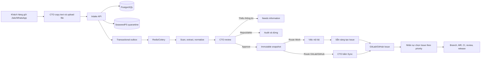
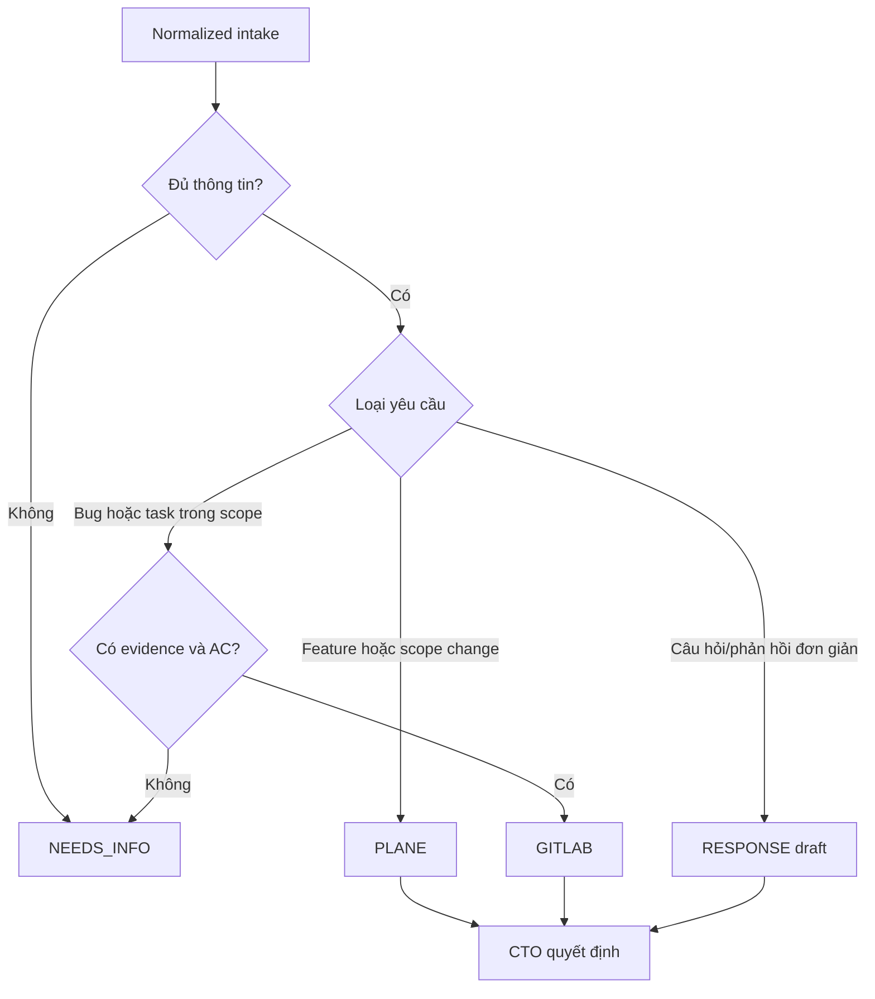
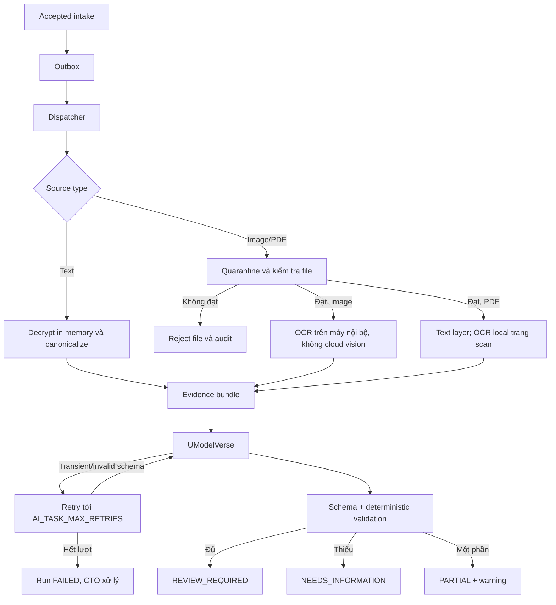
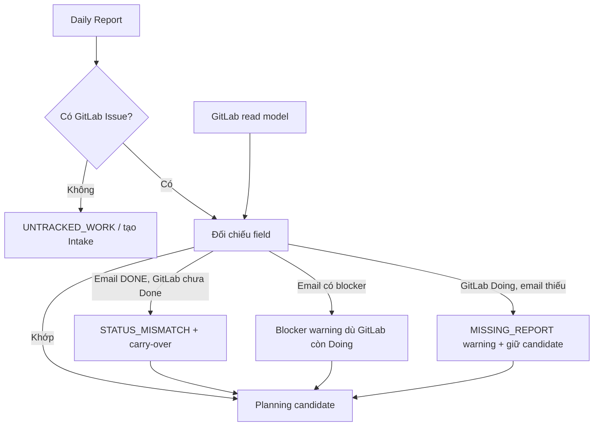
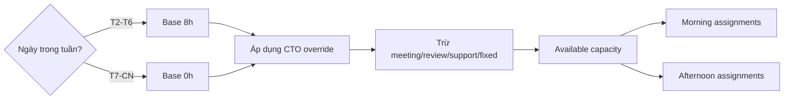
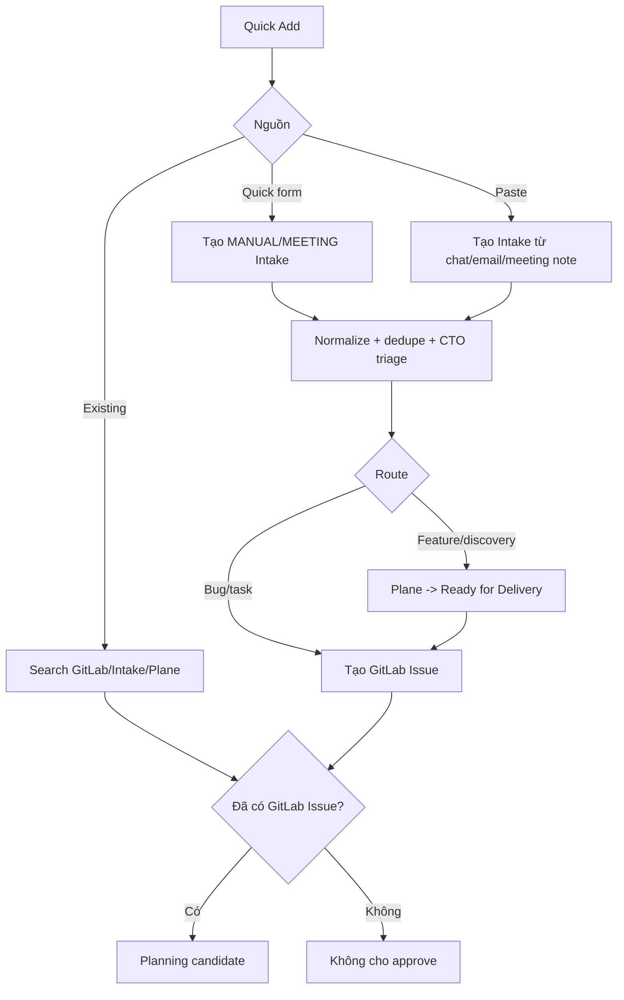
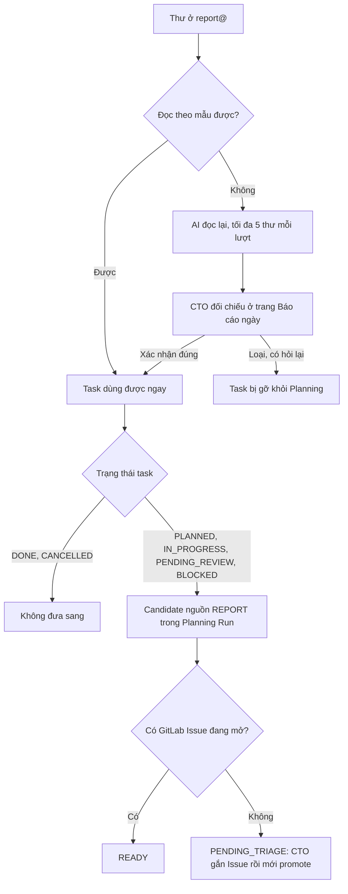
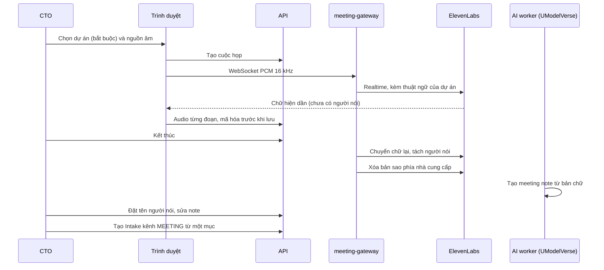
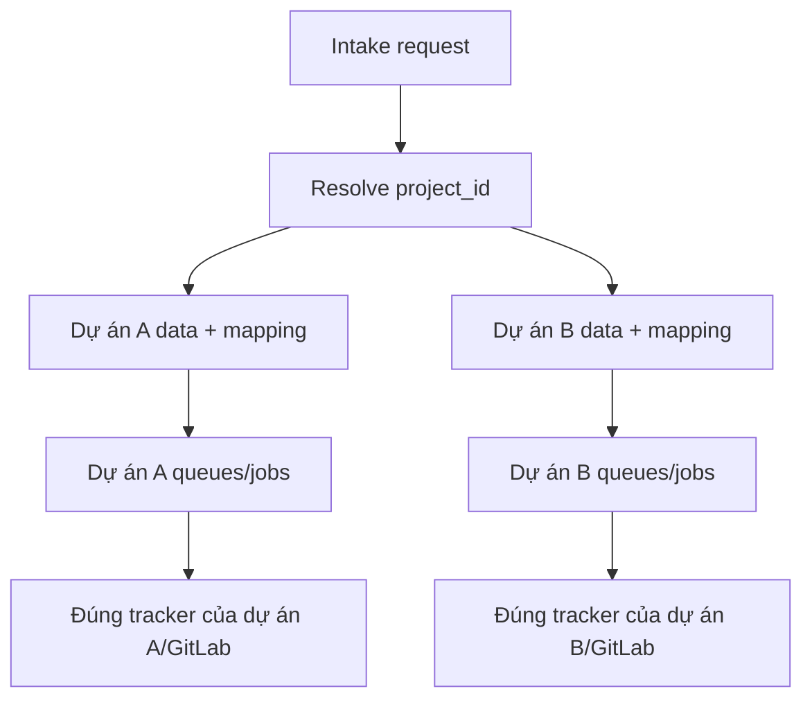

English | [Tiếng Việt](flows.vi.md)

# Standard business flows

_Version 1.2 | Baseline updated 2026-10-01_

The diagrams describe the target flow. Since ADR-0066 and migration 057, Plane is no longer an operational route: old data/links are read-only with the label "Plane · history" ("Plane · lịch sử"); any Plane branch that still appears in the historical parts of this document is not a runnable action. What already has code and what is still missing are separated in `IMPLEMENTATION-INVENTORY.md`.

## 1. From customer chat to team members



## 2. Routing rules



## 3. Two-step Approve and Sync

```mermaid
sequenceDiagram
    actor CTO
    participant UI
    participant API
    participant DB
    participant Worker
    participant External as Plane/GitLab

    CTO->>UI: Sửa payload và Approve
    UI->>API: approve(expected_version, payload)
    API->>DB: transaction action + immutable snapshot
    API-->>UI: APPROVED, chưa external write
    CTO->>UI: Bấm Sync
    UI->>API: sync(snapshot_id)
    API->>DB: validate snapshot + mapping + idempotency; create job/outbox
    API-->>UI: 202 SYNC_PENDING
    Worker->>DB: claim job bằng lease
    Worker->>External: create với idempotency marker
    External-->>Worker: external ID + URL
    Worker->>DB: external_link + job SUCCEEDED
    UI->>API: đọc trạng thái
    API-->>UI: SYNCED
```

If the item changes after approval, the API invalidates the snapshot. Syncing an old snapshot returns `409 APPROVAL_SNAPSHOT_STALE`.

## 4. Text, image and PDF pipeline



The pilot only calls UModelVerse; the OpenRouter fallback is postponed until after the pilot per ADR-0011. File checks cover magic bytes, size, page count and rejection of encrypted PDFs or PDFs with embedded files; the pilot does not use malware scanning. OCR runs in an isolated container on a separate machine on the same LAN; only the OCR text goes into the evidence bundle sent to UModelVerse, and the original file is not sent to the cloud (ADR-0015).

## 5. Daily Report and Planning Run

```mermaid
sequenceDiagram
    participant Mail as Stalwart IMAPS
    participant Worker as IMAPS worker
    participant DB as PostgreSQL
    participant GL as GitLab read model
    participant Report as Report builder
    participant Planner as Planning builder
    participant CTO
    participant Sync as Integration worker

    Worker->>Mail: Fetch unread/new UID qua TLS
    Worker->>DB: Dedupe và lưu encrypted email
    Report->>DB: 23:30 parse report/revision và lưu warning
    Planner->>DB: 06:45 refresh report + capacity
    Planner->>GL: Đọc Issue/state/assignee/milestone/due date/MR/CI
    Planner->>Planner: GitLab delivery truth + email context/conflict
    Planner->>DB: 07:00 tạo run + sáng/chiều + warning
    CTO->>DB: Review priority/assignee/milestone/due date
    CTO->>DB: Approve expected version + immutable snapshot
    DB->>Sync: Enqueue một update job cho mỗi GitLab Issue
    Sync->>GL: Update assignee/milestone/due date idempotent
    Sync->>DB: Per-Issue SUCCEEDED/RETRY/FAILED; run SYNCED/PARTIAL
```

The worker has no SMTP credentials and does not send email.

A missing, late or malformed report does not stop the Planner. On weekends the scheduler still runs; capacity defaults to 0 and only people with a CTO OT override or work evidence are expected to report.

### 5.1. Source of truth and conflicts



GitLab decides the Issue, delivery state, assignee, milestone and due date. Priority comes from the most recent approved Planning snapshot that contains the Issue; if there is none, the GitLab priority label is used (ADR-0013). Email adds hours worked, next steps, blockers, risks and support requests. The UI always shows both values when there is a conflict.

### 5.2. Capacity and shift split



Each person has only one distinct primary development Issue in `Doing`, except for P0 or a CTO override with a reason. Review/QA/support is secondary work but still deducted from capacity.

### 5.3. Unified Quick Add



`report@example.com` only receives Daily Reports and is not used as a Quick Add mailbox. P0 uses Emergency Add: when the CTO confirms with a reason, Intake immediately creates a minimal GitLab Issue through the integration worker, without going through the two steps `Approve` then `Sync`, and records an audit entry (ADR-0012). That Issue becomes a candidate; planning approval is still a separate step.

An assignment missing a milestone or due date only creates a warning that the CTO must acknowledge; a missing GitLab Issue or GitLab user mapping still blocks approval (ADR-0013).

For Quick Add form/paste, the transaction that creates Intake + candidate must commit first; normalize/dedupe is enqueued asynchronously and does not block the response. Before approval the CTO may edit priority, assignee, milestone, due date, slot and planned hours. Priority is only stored in the Planning snapshot during the pilot. If an approved run needs changes, the system creates a new revision of the whole run and only syncs the approved per-Issue delta.

### 5.4. From a reviewed Daily Report to Planning (ADR-0019)



Candidates are created when the run is generated (07:00) and each time the CTO reopens a run that is still editable, so a report confirmed late still gets into the same day's plan. The report used is the one from each member's most recent working day. The signature after the `--` line is not shown in the original email (collapsed) and is not sent to AI.

### 5.5. Meeting recording to Intake (ADR-0018, ADR-0019)



The "upload an existing file" ("tải file có sẵn") source skips the realtime step. Audio only goes to ElevenLabs; UModelVerse only receives the transcript. Every note item belongs to the meeting's project; the Intakes created go through the pipeline and approval like any Intake.

## 6. Multi-project isolation



Workers always load the project/mapping from the job/intake in the database. Routing by a default project in the environment is not allowed.

## 7. Picking work at the start of the day

| Priority | Decided by | Rule |
|---|---|---|
| P0 | CTO | Severe incident; interrupts other work; the Issue is created immediately by Intake through Emergency Add, not added afterwards |
| P1 | CTO in the current phase | Affects a near-term commitment; picked before P2/P3 |
| P2 | CTO in the current phase | Normal planned work |
| P3 | CTO in the current phase | Backlog, optimization or nice-to-have |

The planner proposes Issues based on priority, carry-over, review/QA, milestone, dependencies and `Ready` status; the CTO approves the morning/afternoon plan. In a later phase the Project Owner may approve within projects they are authorized for, and the CTO keeps override rights. Members do not change P0-P3 themselves to pick more convenient work.


## 8. Listening and hot topics for marketing projects (ADR-0068, FR-MKT-08..12)

1. The Project Owner declares content pillars (description, audience, preferred channels, weekly ratio, prioritized keywords and hashtags, sample posts, things to avoid), pastes watch sources, enables social networks among the channels the CTO has opened (Settings > Scan sources ("Cài đặt > Nguồn quét")), and sets the scan cadence and the AI run time (within the ceiling set by the CTO). Page `/nguon`.
2. An external scan flow (n8n, template `docs/stable/flows/watch-rss.n8n.json`) runs every 30 minutes: reads `GET /api/v1/watch/config` (every project that is listening, `next_scan_at`), scans RSS, Google Trends and YouTube by keyword, and sends HMAC-signed batches back to `POST /api/v1/watch/signals` with `project`, `via`, `priority`. Intake does not open any address.
3. Intake receives signals per project (weekly quota, store of 600, deduplicated by address). A beat every 30 minutes triggers an AI pass for projects that have reached their scheduled time: groups signals by keyword, scores them with rules, and AI summarizes them into topics (title, why, angle, suggested channels, notes); if AI fails, the rule-based version stands. Manual "Refresh" ("Làm mới") is limited to 3 times per day.
4. On This week ("Tuần này"), in the "Hot topics of the week" ("Chủ đề nóng tuần") block: the PO reads the analysis and clicks Make post ("Thành bài": the post goes to Ideas ("Ý tưởng") with the source link) or Make series ("Thành chuỗi": a version for each of the pillar's preferred channels with good times), or Drop ("Bỏ": the topic and its signals do not appear again). Metric: topics turned into posts per week.
5. In the post card, each channel version has its own text counted against the channel's rules (over the length limit it cannot be Sent for approval ("Gửi duyệt")) and a short link `/p/<mã>` leading to the landing page with UTM; Intake counts human clicks. Platform metrics at 30 minutes, 6 hours, 24, 48 hours and 7 days are the next slice, A4.
6. Telegram reminders around posting time (FR-MKT-15), every day: at 08:00, today's posting schedule goes to the project group or privately to the Project Owner; 60 minutes before the time, a private reminder to the person doing it (for self-posting channels where the post is not approved yet, the PO is reminded to approve); 30 minutes after the time, if it is not yet Posted ("Đã đăng"), both the person doing it and the PO are reminded. Messages do not contain the post's text.
