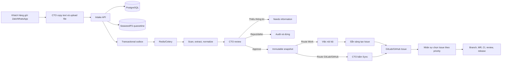
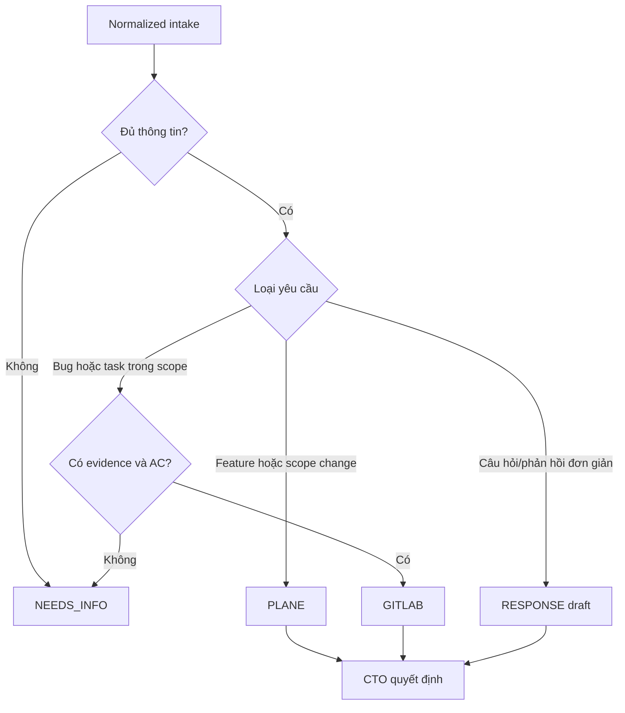
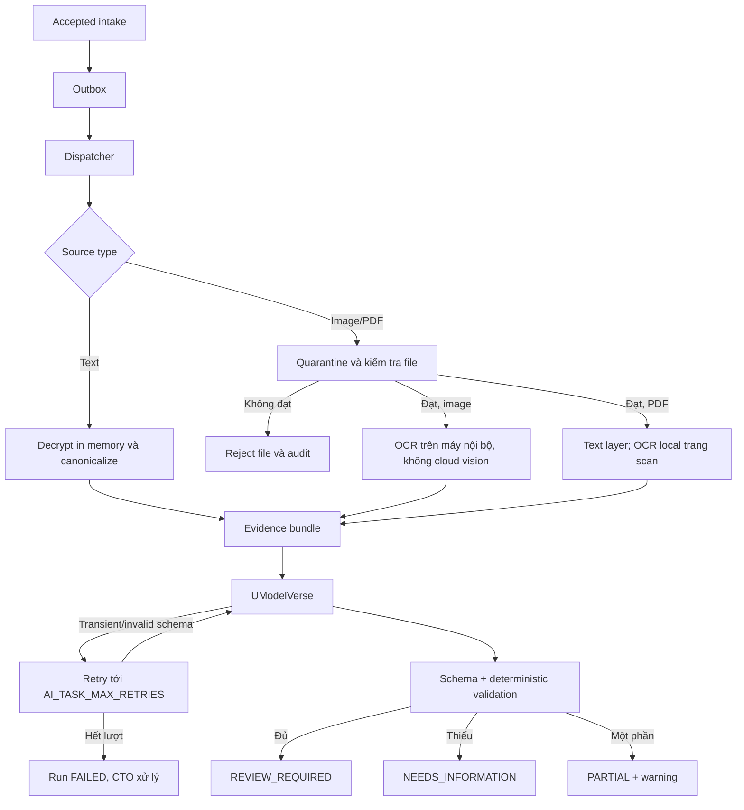
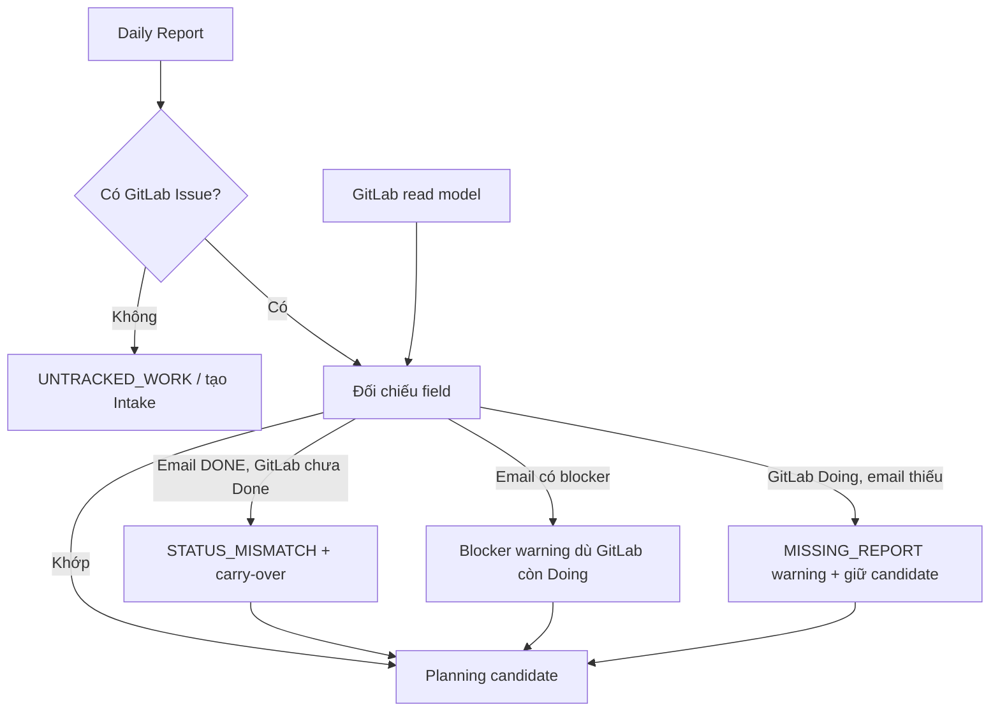
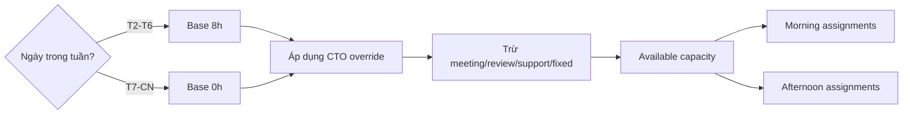
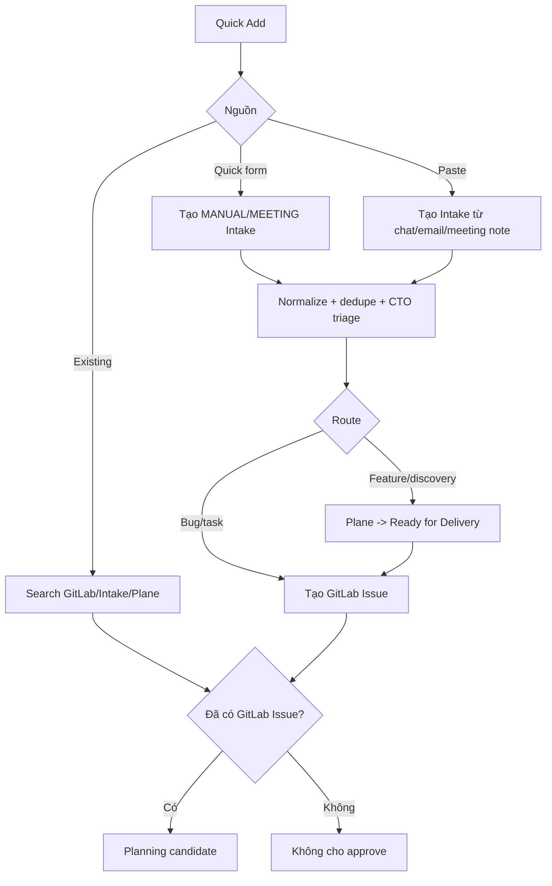
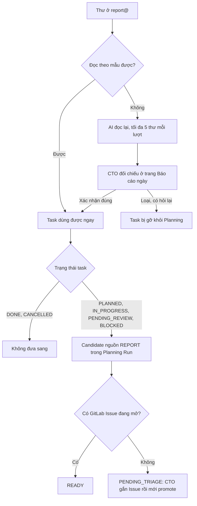
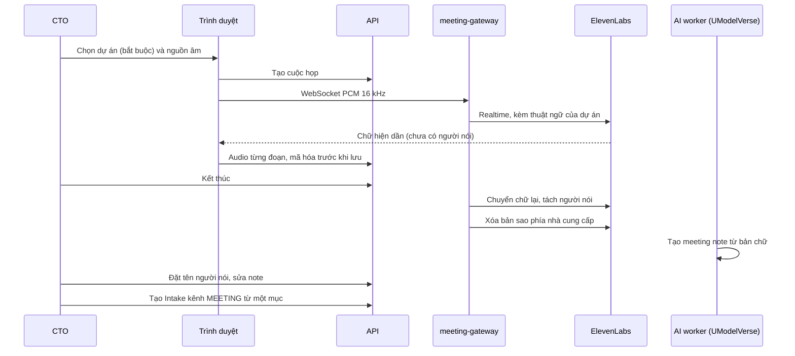
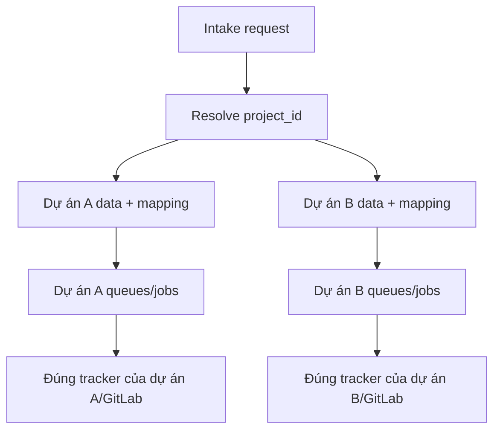

[English](flows.md) | Tiếng Việt

# Luồng nghiệp vụ chuẩn

_Version 1.2 | Baseline cập nhật 2026-10-01_

Các sơ đồ mô tả target flow. Từ ADR-0066 và migration 057, Plane không còn là tuyến vận hành: dữ liệu/link cũ chỉ đọc với nhãn “Plane · lịch sử”; mọi nhánh Plane còn xuất hiện trong phần lịch sử của tài liệu không phải hành động có thể chạy. Phần đã có code và phần còn thiếu được tách tại `IMPLEMENTATION-INVENTORY.md`.

## 1. Từ chat khách hàng tới nhân sự



## 2. Quy tắc routing



## 3. Approve và Sync hai bước

```mermaid
sequenceDiagram
    actor CTO
    participant UI
    participant API
    participant DB
    participant Worker
    participant External as Plane/GitLab

    CTO->>UI: Sửa payload và Approve
    UI->>API: approve(expected_version, payload)
    API->>DB: transaction action + immutable snapshot
    API-->>UI: APPROVED, chưa external write
    CTO->>UI: Bấm Sync
    UI->>API: sync(snapshot_id)
    API->>DB: validate snapshot + mapping + idempotency; create job/outbox
    API-->>UI: 202 SYNC_PENDING
    Worker->>DB: claim job bằng lease
    Worker->>External: create với idempotency marker
    External-->>Worker: external ID + URL
    Worker->>DB: external_link + job SUCCEEDED
    UI->>API: đọc trạng thái
    API-->>UI: SYNCED
```

Nếu item thay đổi sau approval, API invalidates snapshot. Sync snapshot cũ trả `409 APPROVAL_SNAPSHOT_STALE`.

## 4. Pipeline text, image và PDF



Pilot chỉ gọi UModelVerse; OpenRouter fallback hoãn sau pilot theo ADR-0011. Kiểm tra file gồm magic bytes, kích thước, số trang và từ chối PDF mã hóa/có file nhúng; pilot không dùng malware scan. OCR chạy trong container cô lập trên máy riêng cùng LAN; chỉ phần chữ đã OCR đi vào evidence bundle gửi UModelVerse, file gốc không gửi lên cloud (ADR-0015).

## 5. Daily Report và Planning Run

```mermaid
sequenceDiagram
    participant Mail as Stalwart IMAPS
    participant Worker as IMAPS worker
    participant DB as PostgreSQL
    participant GL as GitLab read model
    participant Report as Report builder
    participant Planner as Planning builder
    participant CTO
    participant Sync as Integration worker

    Worker->>Mail: Fetch unread/new UID qua TLS
    Worker->>DB: Dedupe và lưu encrypted email
    Report->>DB: 23:30 parse report/revision và lưu warning
    Planner->>DB: 06:45 refresh report + capacity
    Planner->>GL: Đọc Issue/state/assignee/milestone/due date/MR/CI
    Planner->>Planner: GitLab delivery truth + email context/conflict
    Planner->>DB: 07:00 tạo run + sáng/chiều + warning
    CTO->>DB: Review priority/assignee/milestone/due date
    CTO->>DB: Approve expected version + immutable snapshot
    DB->>Sync: Enqueue một update job cho mỗi GitLab Issue
    Sync->>GL: Update assignee/milestone/due date idempotent
    Sync->>DB: Per-Issue SUCCEEDED/RETRY/FAILED; run SYNCED/PARTIAL
```

Worker không có SMTP credential và không gửi email.

Report thiếu, muộn hoặc sai format không dừng Planner. Cuối tuần scheduler vẫn chạy; capacity mặc định 0 và chỉ người có CTO override OT hoặc work evidence mới bị kỳ vọng report.

### 5.1. Nguồn sự thật và conflict



GitLab quyết định Issue, delivery state, assignee, milestone và due date. Priority lấy từ Planning snapshot đã duyệt gần nhất có chứa Issue; nếu chưa có thì dùng priority label của GitLab (ADR-0013). Email bổ sung giờ làm, bước tiếp theo, blocker, rủi ro và yêu cầu hỗ trợ. UI luôn hiển thị hai giá trị khi có conflict.

### 5.2. Capacity và chia ca



Mỗi người chỉ có một distinct primary development Issue ở `Doing`, trừ P0 hoặc CTO override có lý do. Review/QA/support là secondary work nhưng vẫn trừ capacity.

### 5.3. Unified Quick Add



`report@example.com` chỉ nhận Daily Report, không dùng làm mailbox Quick Add. P0 dùng Emergency Add: khi CTO xác nhận kèm lý do, Intake tự tạo ngay GitLab Issue tối thiểu qua integration worker, không qua hai bước `Approve` rồi `Sync`, và ghi audit (ADR-0012). Issue đó trở thành candidate; planning approval vẫn là bước riêng.

Assignment thiếu milestone hoặc due date chỉ tạo warning cần CTO acknowledge; thiếu GitLab Issue hoặc GitLab user mapping vẫn chặn approval (ADR-0013).

Với Quick Add form/paste, transaction tạo Intake + candidate phải commit trước; normalize/dedupe được enqueue bất đồng bộ và không chặn response. Trước approval CTO được sửa priority, assignee, milestone, due date, slot và planned hours. Priority chỉ lưu trong Planning snapshot ở pilot. Nếu run đã approved cần sửa, hệ thống tạo revision mới toàn run và chỉ sync per-Issue delta đã duyệt.

### 5.4. Từ Daily Report đã xem sang Planning (ADR-0019)



Candidate được tạo lúc run sinh ra (07:00) và mỗi lần CTO mở lại run còn sửa được, nên báo cáo xác nhận muộn vẫn vào kế hoạch trong ngày. Báo cáo dùng là báo cáo của ngày làm việc gần nhất của từng nhân sự. Chữ ký sau dòng `--` không hiện trong thư gốc (thu gọn) và không được gửi cho AI.

### 5.5. Ghi âm cuộc họp tới Intake (ADR-0018, ADR-0019)



Nguồn "tải file có sẵn" bỏ bước realtime. Audio chỉ tới ElevenLabs; UModelVerse chỉ nhận bản chữ. Mọi mục note thuộc dự án của cuộc họp; Intake tạo ra đi qua pipeline và phê duyệt như mọi Intake.

## 6. Multi-project isolation



Worker luôn tải project/mapping từ job/intake trong database. Không được route theo project mặc định trong environment.

## 7. Chọn việc đầu ngày

| Priority | Người quyết định | Quy tắc |
|---|---|---|
| P0 | CTO | Incident nghiêm trọng; ngắt công việc khác; Issue được Intake tạo ngay qua Emergency Add, không bổ sung sau |
| P1 | CTO trong phase hiện tại | Ảnh hưởng cam kết gần; chọn trước P2/P3 |
| P2 | CTO trong phase hiện tại | Công việc kế hoạch thông thường |
| P3 | CTO trong phase hiện tại | Backlog, tối ưu hoặc nice-to-have |

Planner đề xuất Issue theo priority, carry-over, review/QA, milestone, dependency và trạng thái `Ready`; CTO duyệt kế hoạch sáng/chiều. Phase sau Project Owner có thể duyệt trong project được phân quyền, CTO giữ quyền override. Nhân sự không tự đổi P0-P3 để lấy việc thuận tiện hơn.


## 8. Nghe và chủ đề nóng cho dự án marketing (ADR-0068, FR-MKT-08..12)

1. Project Owner khai trụ cột nội dung (mô tả, người đọc, kênh ưu tiên, tỉ lệ tuần, từ khóa và hashtag có ưu tiên, bài mẫu, điều tránh), dán nguồn theo dõi, bật mạng xã hội trong số kênh CTO đã mở (Cài đặt > Nguồn quét), đặt nhịp quét và giờ AI chạy (trong trần CTO đặt). Trang `/nguon`.
2. Luồng quét ngoài (n8n, mẫu `docs/stable/flows/watch-rss.n8n.json`) chạy mỗi 30 phút: đọc `GET /api/v1/watch/config` (mọi dự án đang nghe, `next_scan_at`), quét RSS, Google Trends, YouTube theo từ khóa, gửi lô ký HMAC về `POST /api/v1/watch/signals` với `project`, `via`, `priority`. Intake không mở địa chỉ nào.
3. Intake nhận tín hiệu theo dự án (hạn mức tuần, kho 600, trùng theo địa chỉ). Beat mỗi 30 phút gọi lượt AI cho dự án tới mốc giờ: nhóm tín hiệu theo từ khóa, chấm điểm bằng luật, AI tóm thành chủ đề (tiêu đề, vì sao, góc, kênh gợi ý, lưu ý); AI lỗi thì bản luật đứng. "Làm mới" tay tối đa 3 lần mỗi ngày.
4. Trên Tuần này, khối "Chủ đề nóng tuần": PO đọc phân tích, bấm Thành bài (bài ở Ý tưởng kèm link nguồn) hoặc Thành chuỗi (bản cho từng kênh ưu tiên của trụ với giờ tốt), hoặc Bỏ (chủ đề và tín hiệu của nó không hiện lại). Số đo: chủ đề thành bài mỗi tuần.
5. Trong thẻ bài, mỗi bản kênh có chữ riêng đếm theo luật kênh (vượt mức dài thì không Gửi duyệt được) và một link rút gọn `/p/<mã>` dẫn về trang đích kèm UTM; Intake đếm click người. Số liệu nền tảng theo mốc 30 phút, 6 giờ, 24, 48 giờ, 7 ngày là lát A4 kế tiếp.
6. Telegram nhắc quanh giờ đăng (FR-MKT-15), mọi ngày: 08:00 lịch đăng hôm nay vào nhóm dự án hoặc riêng Project Owner; 60 phút trước giờ nhắc riêng người làm (kênh tự đăng mà bài chưa duyệt thì nhắc PO duyệt); 30 phút sau giờ mà chưa Đã đăng thì nhắc cả người làm và PO. Tin không chứa chữ của bài.
